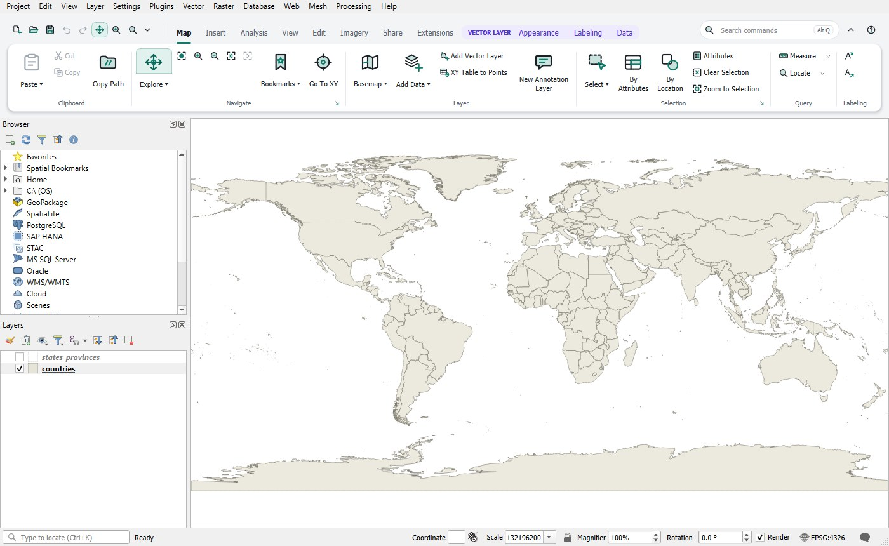
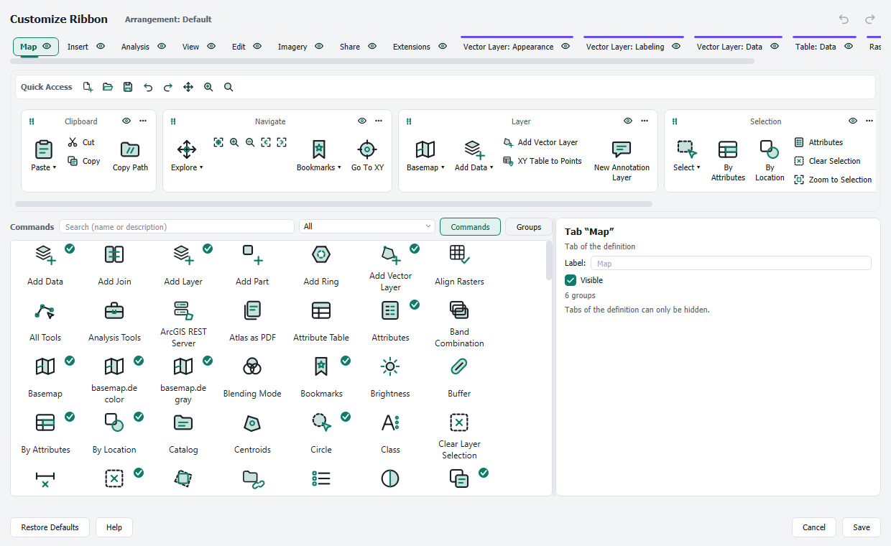
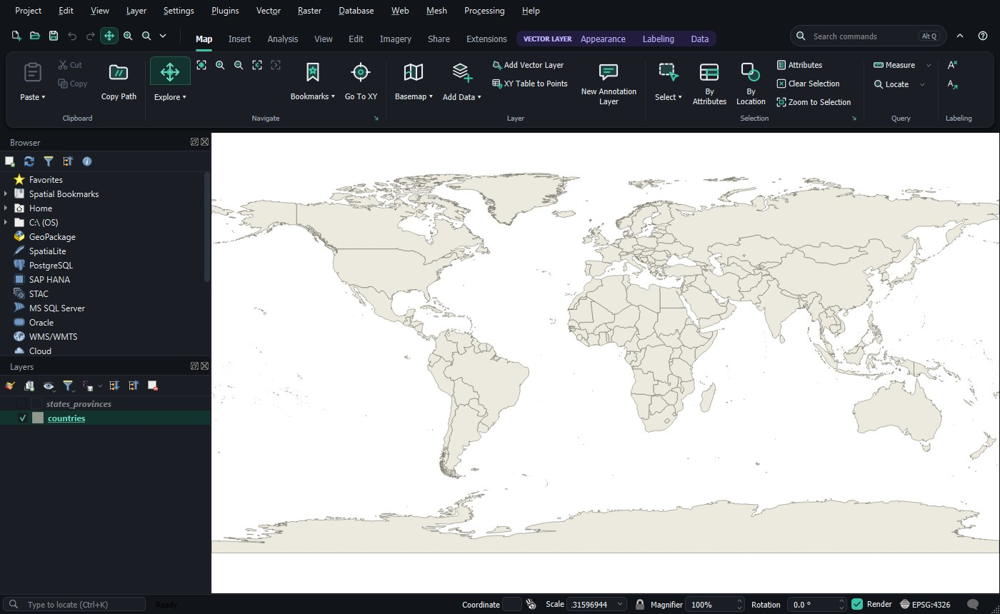

# QGIS Ribbon

A ribbon interface for [QGIS](https://qgis.org): commands sorted into tabs and groups, contextual tabs for the active layer, a Quick Access Toolbar, KeyTips for the keyboard and a command search, instead of the QGIS toolbars.

*Deutsch: [siehe unten](#deutsch).*



## Features

- **Tabs** Map, Insert, Analysis, View, Edit, Imagery, Share and Extensions; **contextual tabs** for vector layers, tables and rasters.
- **Controls:** large, medium and small buttons, split buttons, menus, galleries, fields for scale, opacity or fonts, dialog launchers, rich tooltips; groups collapse in narrow windows.
- **Quick Access Toolbar**, **KeyTips** (press Alt), **command search** (Alt, then Q), minimizing (Ctrl+F1).
- **Ribbon editor:** drag and drop commands into any group, create your own tabs and groups, hide and reorder, fully usable by keyboard, with undo.
- **Arrangements:** save, load, export and import complete ribbon setups as JSON files.
- **Appearance:** automatic, light or dark, three accent colors, own icon set, optional style for the whole QGIS window.
- **Extensions tab:** commands of installed plugins, your own Processing scripts and models, every toolbox tool.
- **Extra tools** where QGIS has no single command, for example a dialog for attribute domains.
- **English and German** user interface, following the QGIS language, with a built-in illustrated **guide** (Help › Plugins › QGIS Ribbon Guide).
- The ribbon only calls existing QGIS functions. The menu bar and panels stay unchanged. Deactivating the plugin, or **Classic QGIS Interface**, restores the QGIS toolbars and window layout exactly.

| | |
|---|---|
|  |  |

## Installation

In QGIS: **Plugins › Manage and Install Plugins …**, search for *QGIS Ribbon*, **Install**.

Manual installation: download the ZIP of a release and use **Install from ZIP** in the same dialog.

Requirements: QGIS 3.44 or later (QGIS 3.x, Qt 5). Developed and tested on Windows. No extra Python packages (PyYAML ships with QGIS).

## Documentation

The guide is part of the plugin and also readable here:

- English: [qgis_ribbon/help/en/index.md](qgis_ribbon/help/en/index.md)
- Deutsch: [qgis_ribbon/help/de/index.md](qgis_ribbon/help/de/index.md)

## Relation to ArcGIS Pro

The layout follows the ribbon concept of ArcGIS Pro so that users switching from it find their way around QGIS quickly. QGIS Ribbon is an independent project. It is **not affiliated with, sponsored or endorsed by Esri**. It contains no Esri icons, texts or graphics; all labels, descriptions and icons are its own. ArcGIS and ArcGIS Pro are trademarks of Esri.

## Reporting problems

Please use the [issue tracker](https://github.com/8snv5d5zcy-glitch/qgis-ribbon/issues). Helpful details: QGIS version, operating system, steps to reproduce, and messages from the log panel (tab *QGIS Ribbon*).

## Development

```
qgis_ribbon/            the plugin (packaged into the ZIP)
  core/                 pure Python, no qgis imports, tested with pytest
  qgis_integration/     connection to QGIS
  ui/                   widgets and dialogs
  config/               ribbon definition (YAML), icons, themes
  i18n/                 translation catalogs (English -> German)
  help/                 guide pages and screenshots
tests/                  pytest (core without QGIS, qgis_app with QGIS)
tools/                  ZIP build, icon builder, guide screenshots, test runner for QGIS
```

- Tests without QGIS: `python -m pytest` (Python 3, pytest, PyYAML; tests that need QGIS are left out).
- All tests in QGIS Python (Windows): `tools\qgis_pytest.cmd`.
- Build the plugin ZIP: `python tools/build_zip.py` (writes `dist/qgis_ribbon-<version>.zip`).
- English is the source language. German texts are in `qgis_ribbon/i18n/de.json` (texts in the code) and `de_ribbon.json` (texts of the ribbon definition). Other languages can be added as `<lang>.json` and `<lang>_ribbon.json`.
- The ribbon definition `qgis_ribbon/config/ribbon_arcgis.yaml` describes tabs, groups, commands (with the QGIS action, menu, dialog or Processing tool they call), conditions and galleries; `core/config_loader.py` checks it on load.
- Icons are drawn at runtime from `config/icons/kontur.yaml`, which `tools/kontur_icons.py` generates.
- Screenshots of the guide: `tools/guide_screenshots.py` (runs inside QGIS, uses the Natural Earth world map shipped with QGIS).

## License

Copyright (C) 2026 Paul Liecke

This program is free software; you can redistribute it and/or modify it under the terms of the GNU General Public License as published by the Free Software Foundation; either version 2 of the License, or (at your option) any later version. See [LICENSE](LICENSE).

Screenshots show map data from [Natural Earth](https://www.naturalearthdata.com) (public domain). The basemaps offered in the ribbon have their own terms: basemap.de © GeoBasis-DE / BKG (CC BY 4.0), OpenTopoMap © OpenStreetMap contributors, SRTM, © OpenTopoMap (CC-BY-SA).

---

## Deutsch

QGIS Ribbon ersetzt die Werkzeugleisten von QGIS durch ein Ribbon: Befehle in Tabs und Gruppen, Kontext-Tabs für den aktiven Layer, Schnellzugriffsleiste, Tastaturkürzel (Alt) und Befehlssuche. Das Ribbon lässt sich grafisch anpassen; Anordnungen lassen sich speichern und als Datei weitergeben. Die Oberfläche gibt es auf Deutsch und Englisch, sie folgt der Sprache von QGIS.

- Installation: **Erweiterungen › Erweiterungen verwalten und installieren …**, nach *QGIS Ribbon* suchen, **Installieren**.
- Anleitung: im Plugin unter **Hilfe › Erweiterungen › Anleitung QGIS Ribbon** oder hier: [qgis_ribbon/help/de/index.md](qgis_ribbon/help/de/index.md).
- Das Ribbon ruft nur vorhandene QGIS-Funktionen auf. Abschalten stellt die Werkzeugleisten von QGIS genau wieder her.
- Das Bedienkonzept folgt ArcGIS Pro. QGIS Ribbon ist ein unabhängiges Projekt, nicht mit Esri verbunden und nicht von Esri unterstützt, und enthält keine Icons, Texte oder Grafiken von Esri.
- Lizenz: GNU GPL Version 2 oder später.
