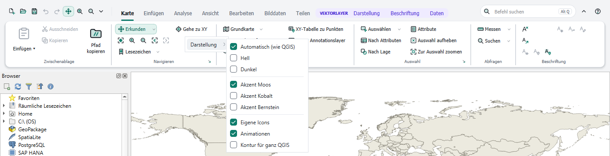
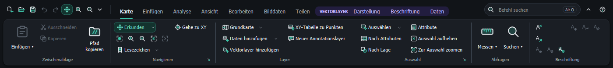
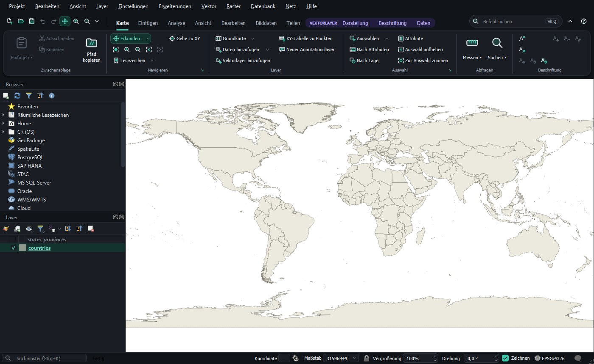

# Darstellung

[Inhalt](index.md)

Das Untermenü **Darstellung** im Menü ▾ der Schnellzugriffsleiste und im Rechtsklick-Menü des Ribbons steuert das Aussehen. Änderungen wirken sofort.

| Eintrag | Wirkung |
|---|---|
| Automatisch (wie QGIS) | hell oder dunkel, je nach QGIS-Thema |
| Hell, Dunkel | fester Modus |
| Akzent Moos, Kobalt, Bernstein | Farbe des gewählten Tabs, der Hervorhebungen und Buttons |
| Eigene Icons | die Icons des Ribbons; ausgeschaltet nimmt das Ribbon die QGIS-Icons |
| Animationen | kurze Übergänge, zum Beispiel beim Tabwechsel |
| Kontur für ganz QGIS | Bedienfelder, Layerbaum, Menüleiste und Statusleiste im selben Stil wie das Ribbon |

Mit **Kontur für ganz QGIS** folgt das ganze Fenster dem Ribbon:

Ausschalten stellt den vorherigen Stil von QGIS genau wieder her. Im Hochkontrastmodus von Windows nimmt das Ribbon die Systemfarben.

## QGIS-Menüleiste ausblenden

Das Ribbon enthält die Befehle der Menüleiste. Wer den Platz für die Karte braucht, wählt **QGIS-Menüleiste ausblenden** im Menü ▾ oder im Rechtsklick-Menü. Die Menüs bleiben erreichbar:

- über den Knopf **☰** ganz links in der Kopfzeile des Ribbons (alle Menüs der Menüleiste, auch die von Plugins),
- mit **Alt+Buchstabe** wie bisher (zum Beispiel Alt+J für Projekt),
- über die Befehle **QGIS-Menüs** und **Menü Projekt**, **Menü Einstellungen** … im Editor, die sich in eigene Gruppen oder die Schnellzugriffsleiste legen lassen.

Auf dem Mac steht die Menüleiste oben am Bildschirmrand, der Eintrag fehlt dort. Tastenkürzel wie Strg+S bleiben aktiv. Erneutes Wählen blendet die Menüleiste wieder ein. QGIS merkt sich die Einstellung; in der klassischen QGIS-Oberfläche und nach dem Abschalten des Plugins ist die Menüleiste immer da.

## Klassische QGIS-Oberfläche

**Klassische QGIS-Oberfläche** im Menü ▾ oder im Rechtsklick-Menü baut das Ribbon ab und bringt die Werkzeugleisten von QGIS so zurück, wie sie waren. QGIS merkt sich das für den nächsten Start.

Zurück zum Ribbon geht es über **Ansicht › Ribbon-Oberfläche** in der Menüleiste von QGIS.

Auch Deaktivieren oder Deinstallieren des Plugins stellt die Werkzeugleisten und die Fensteraufteilung von QGIS wieder her.
