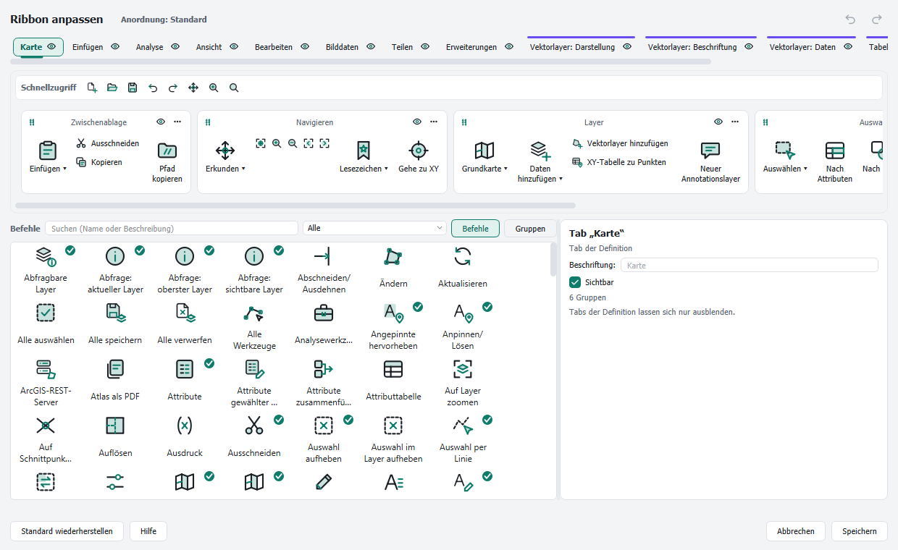
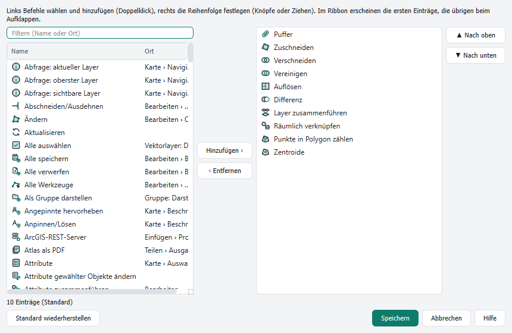

# Ribbon anpassen

[Inhalt](index.md)

Alles im Ribbon lässt sich ändern: Tabs und Gruppen ausblenden oder löschen, umbenennen und umsortieren, Befehle in jede Gruppe legen, eigene Tabs und Gruppen anlegen und die Befehle der Schnellzugriffsleiste und der Galerien wählen. Eine Zusammenstellung dieser Änderungen heißt **Anordnung**.

## Der Editor

**Ribbon anpassen …** im Menü ▾ der Schnellzugriffsleiste oder im Rechtsklick-Menü des Ribbons öffnet den Editor. Er sieht aus wie das Ribbon selbst.

- **Oben:** die Tabs. Kontext-Tabs stehen rechts und tragen ihre Farbe.
- **Schnellzugriff:** die Befehle der Schnellzugriffsleiste.
- **Mitte:** eine Vorschau des gewählten Tabs mit seinen Gruppen.
- **Unten links:** die Befehle. **Suchen** findet sie nach Name oder Beschreibung. Die Liste daneben filtert: *Alle*, *Nicht im Ribbon*, *Erweiterungen (Plugins)*, *Eigene Skripte und Modelle*, *Werkzeugkasten (alle Werkzeuge)* oder ein Tab. *Nicht im Ribbon* enthält auch weitere QGIS-Befehle ohne festen Platz im mitgelieferten Ribbon, etwa Herauszoomen, Aktualisieren, Zeitsteuerung, Layer duplizieren, Projekt schließen, Tastenkürzel, die Seiten der Layereigenschaften (**Eigenschaften: …**), der Projekteigenschaften und der Optionen (**Optionen: …**), **Erweiterungen verwalten und installieren**, die Dekorationen, die Hilfe-Befehle und jedes Menü der QGIS-Menüleiste als Dropdown (**Menü Projekt**, **Menü Einstellungen** …, alle zusammen: **QGIS-Menüs**). Ein Häkchen zeigt, dass ein Befehl schon im gewählten Tab steht. **Gruppen** zeigt ganze Gruppen statt einzelner Befehle.
- **Unten rechts:** die Eigenschaften des gewählten Tabs, der Gruppe oder des Befehls (Beschriftung, Sichtbarkeit, Größe).

Im Ribbon ändert sich erst etwas mit **Speichern**. **Abbrechen** fragt nach, bevor Änderungen verworfen werden. Jeder Schritt lässt sich mit den Pfeilen oben rechts rückgängig machen (Strg+Z, Strg+Y). **Standard wiederherstellen** setzt Tabs, Gruppen und Schnellzugriff auf den gelieferten Stand zurück; auch das lässt sich rückgängig machen.

### Was geht

| Aufgabe | Maus | Tastatur |
|---|---|---|
| Tab wählen | Tab anklicken | Pfeil links/rechts in der Tableiste |
| Befehl einfügen | aus den Befehlen in eine Gruppe ziehen; eine Marke zeigt den Platz | Gruppe oder Eintrag wählen, Befehl wählen, Eingabe |
| Eintrag verschieben | ziehen, auch in eine andere Gruppe; über einem anderen Tab kurz verweilen wechselt dorthin | Strg+Pfeil; Strg+X, Ziel wählen, Strg+V |
| Neue Gruppe | **＋ Gruppe** anklicken oder einen Befehl darauf ziehen | **＋ Gruppe** wählen, Eingabe |
| Gruppe verschieben | am Kopf ziehen | Gruppenkopf wählen, Strg+Pfeil |
| Gruppe eines anderen Tabs übernehmen | Befehle auf **Gruppen** umschalten, Kachel in die Vorschau oder auf einen Tab ziehen | Kachel wählen, Eingabe |
| Neuer Tab | **＋ Tab** | – |
| Tabs sortieren | Tab ziehen (Haupt-Tabs bleiben vor den Kontext-Tabs) | Tab wählen, Strg+Pfeil |
| Entfernen, Löschen | zurück in die Befehle ziehen | Entf |
| Gelöschten Tab zurückholen | **Gelöschten Tab wiederherstellen** unten im Fenster | – |
| Ein- und ausblenden | Auge an Tab oder Gruppe | Leertaste |
| Umbenennen | Doppelklick (eigene Tabs, alle Gruppen) | F2 |
| Größe eines Eintrags | Eigenschaften: groß, mittel, klein | – |
| Schnellzugriff | Befehl in die Zeile Schnellzugriff ziehen, dort sortieren, zum Entfernen zurückziehen | Strg+Q in den Befehlen, Strg+Pfeil, Entf |
| Eine Gruppe zurücksetzen | Menü ⋯ der Gruppe oder Eigenschaften | – |
| Rückgängig, Wiederholen | Pfeile oben rechts | Strg+Z, Strg+Y |

Hinweise:

- Auf dem Mac gilt ⌘ statt Strg, ⇧⌘Z zum Wiederholen, ⌃Q für den Schnellzugriff und ⌫ zum Entfernen (siehe [Tastatur](keyboard.md)).
- Ein Befehl steht höchstens einmal in einer Gruppe, im selben Tab aber gern mehrfach.
- Kontext-Tabs nehmen nur Befehle, die dort funktionieren können.
- Eine Gruppe des gelieferten Ribbons wird bei der ersten Änderung zur eigenen Fassung. Sie ist als *angepasst* markiert und lässt sich einzeln zurücksetzen.
- Split-Buttons, Menüs, Galerien und Zeilen kleiner Buttons bleiben je eine Einheit. Sie lassen sich verschieben und entfernen; ▾ zeigt ihren Inhalt. Was im Dropdown steht, lässt sich anpassen (siehe unten).
- Leere eigene Gruppen werden beim Speichern verworfen.
- Auch Tabs und Gruppen des gelieferten Ribbons lassen sich löschen. Vor dem Löschen eines Standard-Tabs fragt der Editor nach; Gruppen werden ohne Rückfrage gelöscht.
- Eine gelöschte Gruppe holt die Palette **Gruppen** zurück, einen gelöschten Tab samt seinen Gruppen **Gelöschten Tab wiederherstellen**. **Standard wiederherstellen** bringt alles zurück.
- Kontext-Tabs lassen sich nur ausblenden, und mindestens ein Haupt-Tab bleibt immer.
- Die Befehle gelöschter Tabs und Gruppen bleiben über die Suche und die Befehle im Editor erreichbar; Einträge im Schnellzugriff bleiben stehen.

## Galerie anpassen

Galerien legen fest, was ein Button mit Auswahl zeigt, zum Beispiel die Geoverarbeitungswerkzeuge im Tab Analyse, die Editorwerkzeuge oder die Grundkarten im Tab Karte. Zum Anpassen eine Galerie im Ribbon mit der rechten Maustaste anklicken und **Galerie „…“ anpassen …** wählen. Alternativ im Editor die Galerie auswählen und **Galerie anpassen …** drücken; Werkzeug- und Analysewerkzeuge haben den Eintrag auch in ihrem Menü.

Befehle links doppelt anklicken oder mit **Hinzufügen ›** übernehmen. Die Reihenfolge rechts mit **Nach oben** und **Nach unten** oder durch Ziehen festlegen. Zur Auswahl stehen alle Buttons, auch Befehle anderer Plugins und Werkzeuge der Toolbox. Galerien im Ribbon zeigen die ersten Einträge direkt, die übrigen beim Aufklappen. In Galerien mit Auswahlmenü erscheinen die Einträge als Kacheln oben im Menü; was QGIS selbst liefert (etwa Lesezeichen oder XYZ-Verbindungen), steht weiter darunter. **Standard wiederherstellen** bringt die gelieferten Einträge zurück.

## Dropdown anpassen

Auch die Dropdowns von Split-Buttons und Menüs lassen sich füllen, zum Beispiel **Erweitertes Digitalisieren** im Tab Bearbeiten. Im Editor einen Befehl aus der Palette auf die Mitte eines Buttons mit ▾ ziehen: Der Button wird hervorgehoben, beim Loslassen kommt der Befehl ans Ende seines Dropdowns. Eine Kachel eines einfachen Befehls lässt sich ebenso hineinziehen; sie verschwindet dann aus der Gruppe. Am Rand des Buttons abgelegt, landet der Befehl wie gewohnt daneben.

Reihenfolge und Einträge legt **Dropdown anpassen …** in den Eigenschaften des Buttons fest, im selben Dialog wie bei Galerien. Auch hier stehen Befehle anderer Plugins zur Wahl. Die Änderung gilt überall, wo der Button steht, und lässt sich im Editor rückgängig machen. Fehlt ein Plugin später, bleibt sein Eintrag grau stehen, bis es wieder geladen ist.

## Anordnungen

Das Untermenü **Anordnungen** im Menü ▾ und im Rechtsklick-Menü verwaltet die Anordnungen:

- Die zuletzt geladene oder gespeicherte Anordnung ist die aktuelle; sie ist abgehakt. **Anordnung „…“ speichern** schreibt Änderungen in sie zurück, ohne Rückfrage. Ohne aktuelle Anordnung heißt der Eintrag **Anordnung speichern …** und fragt nach einem Namen.
- **Aktuelle Anordnung speichern unter …** legt eine neue Anordnung an. Gibt es den Namen schon, fragt das Ribbon, ob sie überschrieben werden soll.
- Eine gespeicherte Anordnung anklicken lädt sie. Sind Änderungen nicht gespeichert, fragt das Ribbon vorher nach.
- **Standardanordnung** lädt das Ribbon wie geliefert (Tabs, Gruppen, Galerien, Schnellzugriff und Kürzel).
- **Löschen** entfernt eine gespeicherte Anordnung.
- **Exportieren …** schreibt die aktuelle Anordnung in eine JSON-Datei, zum Beispiel zum Weitergeben an Kolleginnen und Kollegen. **Importieren …** lädt eine solche Datei.

Nennt eine Anordnung Befehle, die es in dieser QGIS-Installation nicht gibt (zum Beispiel von einem nicht installierten Plugin), erscheinen sie ausgegraut oder werden beim Import mit einem Hinweis übergangen.
