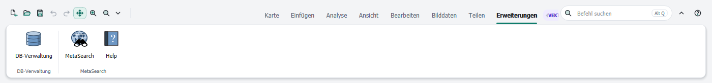

# Erweiterungen

[Inhalt](index.md)

## Tab Erweiterungen

Der Tab **Erweiterungen** sammelt die Befehle installierter QGIS-Plugins: ihre Menüeinträge und Werkzeugleisten, je Plugin eine Gruppe. Er aktualisiert sich, wenn Plugins installiert, aktiviert oder entfernt werden. Ohne Plugins erscheint der Tab nicht.

Solange das Ribbon aktiv ist, sind die Werkzeugleisten der Plugins ausgeblendet; ihre Befehle stehen im Tab Erweiterungen. In der [klassischen QGIS-Oberfläche](appearance.md) und nach dem Abschalten des Ribbons sind sie wieder da.

Die Gruppen des Tabs Erweiterungen verhalten sich wie alle anderen Gruppen: Sie lassen sich im Editor ausblenden, umsortieren und ändern (siehe [Ribbon anpassen](customize.md)).

## Plugin-Befehle in eigenen Gruppen

Im Editor listet der Filter **Erweiterungen (Plugins)** alle Plugin-Befehle. Sie lassen sich in jede Gruppe oder in die Schnellzugriffsleiste ziehen.

Wird ein Plugin später deaktiviert oder entfernt, bleiben seine Befehle in den eigenen Gruppen, aber ausgegraut. Sobald das Plugin wieder da ist, funktionieren sie wieder.

## Eigene Skripte, Modelle und Werkzeuge des Werkzeugkastens

Eigene Processing-Skripte und -Modelle stehen im Editor unter **Eigene Skripte und Modelle**. **Werkzeugkasten (alle Werkzeuge)** listet jedes Werkzeug des Processing-Werkzeugkastens. Sie lassen sich wie jeder andere Befehl in eine Gruppe oder eine Galerie ziehen.

Ein Werkzeug im Ribbon öffnet seinen gewohnten Processing-Dialog. Ein gelöschtes Skript oder Modell bleibt in den eigenen Gruppen ausgegraut, bis es wieder vorhanden ist.
