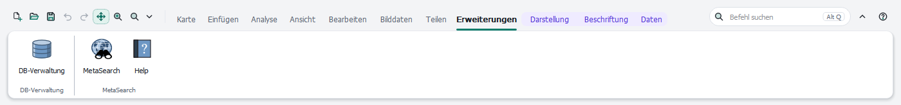

# Erweiterungen

[Inhalt](index.md)

## Tab Erweiterungen

Der Tab **Erweiterungen** sammelt die Befehle installierter QGIS-Plugins: ihre Menüeinträge und Werkzeugleisten, je Plugin eine Gruppe. Er aktualisiert sich, wenn Plugins installiert, aktiviert oder entfernt werden. Ohne Plugins erscheint der Tab nicht.

Auch Plugins mit einem eigenen Menü in der Menüleiste erscheinen hier, ebenso Befehle, die ein Plugin in Menüs oder Leisten von QGIS ablegt (zum Beispiel unter Layer › Layer hinzufügen). Untermenüs eines Plugins mit mehreren Einträgen werden ein Dropdown-Button; jeder Eintrag darin lässt sich trotzdem einzeln in eigene Gruppen ziehen und über die Suche finden. Den Inhalt dieser Dropdowns bestimmt das Plugin. Haben mehrere Befehle eines Plugins denselben Text, stehen sie alle im Tab.

Solange das Ribbon aktiv ist, sind die Werkzeugleisten der Plugins ausgeblendet; ihre Befehle stehen im Tab Erweiterungen. In der [klassischen QGIS-Oberfläche](appearance.md) und nach dem Abschalten des Ribbons sind sie wieder da.

Die Gruppen des Tabs Erweiterungen verhalten sich wie alle anderen Gruppen: Sie lassen sich im Editor ausblenden, umsortieren und ändern (siehe [Ribbon anpassen](customize.md)).

Im Layout-Fenster gibt es den Tab ebenfalls, nur wenn Plugins eigene Befehle in dessen Leisten legen, siehe [Ribbon im Layout-Fenster](layout.md).

## Plugin-Befehle in eigenen Gruppen

Im Editor listet der Filter **Erweiterungen (Plugins)** alle Plugin-Befehle. Sie lassen sich in jede Gruppe oder in die Schnellzugriffsleiste ziehen.

Wird ein Plugin später deaktiviert oder entfernt, blendet der Ribbon seine Befehle in den eigenen Gruppen und im Schnellzugriff aus. Sobald das Plugin wieder da ist, erscheinen sie wieder. Endgültig entfernen lassen sie sich im Editor mit **Verwaiste Einträge entfernen …**. Ein neu geladenes Plugin übernimmt der Ribbon sofort.

Mit vielen Plugins passt der Tab nicht in die Fensterbreite. Wie in jedem Tab werden die Gruppen dann von rechts schmaler, ihre Buttons und Icons kleiner. Ungenutzte Plugin-Gruppen im Editor ausblenden oder die wichtigsten Befehle in einen eigenen Tab legen.

## Eigene Skripte, Modelle und Werkzeuge des Werkzeugkastens

Eigene Processing-Skripte und -Modelle stehen im Editor unter **Eigene Skripte und Modelle**. **Werkzeugkasten (alle Werkzeuge)** listet jedes Werkzeug des Processing-Werkzeugkastens. Sie lassen sich wie jeder andere Befehl in eine Gruppe oder eine Galerie ziehen.

Ein Werkzeug im Ribbon öffnet seinen gewohnten Processing-Dialog. Ein gelöschtes Skript oder Modell ist im Ribbon ausgeblendet, bis es wieder vorhanden ist. Eigene Skripte ohne eigenes Icon zeigen ein Skriptsymbol (Blatt mit Ausführen-Dreieck) statt des Zahnrads von QGIS.
