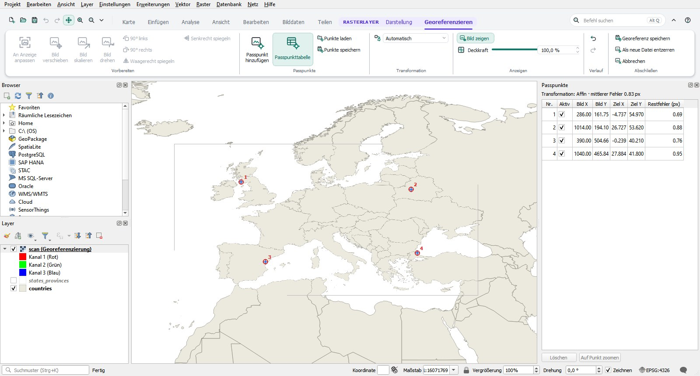
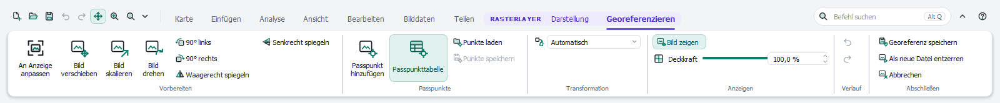

# Georeferenzieren in der Karte

[Inhalt](index.md)

Ein eingescanntes Blatt, ein Luftbild oder ein Plan ohne Lage lässt sich direkt in der Karte einpassen: grob von Hand verschieben, skalieren und drehen, dann mit Passpunkten genau einhängen. Dabei sind alle anderen Layer zu sehen, und Passpunkte rasten auf deren Stützpunkte und Kanten ein. Den eigenen Georeferenzierer von QGIS gibt es weiterhin.

## Starten

**Bilddaten › Ausrichten › Georeferenzieren** startet die Sitzung:

- Ist ein Rasterlayer aus einer Bilddatei aktiv, nimmt das Ribbon dieses Bild; der Layer wird für die Dauer der Sitzung ausgeblendet.
- Sonst fragt es nach einer Bilddatei.

Das Bild erscheint als Arbeitslayer oben in der Layerliste. Hat es schon eine Georeferenz im Bezugssystem der Karte, liegt es dort, sonst mittig im aktuellen Kartenausschnitt. Der Kontext-Tab **Georeferenzieren** öffnet sich. Die Bilddatei selbst bleibt unverändert, bis Sie **Georeferenz speichern** wählen.

Der untere Teil des Buttons (**QGIS-Georeferenzierer**) öffnet den Georeferenzierer von QGIS.

## Grob einpassen

Gruppe **Vorbereiten**:

- **An Anzeige anpassen** legt das Bild mittig in den Kartenausschnitt.
- **Bild verschieben**, **Bild skalieren** und **Bild drehen** sind Kartenwerkzeuge: Ziehen mit der Maus zeigt das Bild sofort in der neuen Lage. Beim Skalieren bleibt das Seitenverhältnis; mit gedrückter Umschalttaste geht es frei. Beim Drehen rastet Strg auf 15°-Schritte ein. Esc bricht das Ziehen ab.
- **90° links**, **90° rechts**, **Waagerecht spiegeln** und **Senkrecht spiegeln** drehen oder spiegeln um die Bildmitte.

Sobald es Passpunkte gibt, rechnet das Ribbon die Lage aus ihnen; die Werkzeuge zum Einpassen von Hand sind dann gesperrt.

## Passpunkte

Gruppe **Passpunkte**:

1. **Passpunkt hinzufügen** wählen.
2. Auf eine Stelle im Bild klicken (ein blaues Kreuz markiert sie).
3. Auf dieselbe Stelle in der Karte klicken. Das Einrasten von QGIS gilt; ein roter Kreis markiert das Ziel.

Rechtsklick oder Esc verwirft einen halb gesetzten Punkt. Nach jedem Punkt rechnet das Ribbon die Lage neu und zeigt das Bild sofort dort.

**Passpunkttabelle** zeigt oder verbirgt das Bedienfeld **Passpunkte** rechts im Fenster:

- je Punkt Bild- und Zielkoordinaten und der Restfehler in Bildpunkten,
- das Häkchen in **Aktiv** nimmt einen Punkt aus der Rechnung, ohne ihn zu löschen,
- eine gewählte Zeile hebt den Punkt in der Karte hervor; **Auf Punkt zoomen** springt dorthin,
- **Löschen** entfernt die gewählten Punkte,
- darunter steht die verwendete Transformation mit dem mittleren Fehler.

**Punkte speichern** und **Punkte laden** nutzen das Punktformat des QGIS-Georeferenzierers (`.points`). Punkte aus einem anderen Bezugssystem rechnet das Ribbon beim Laden in das der Karte um.

## Transformation

Die Auswahl **Transformation** legt fest, wie die Lage aus den Passpunkten gerechnet wird:

| Transformation | Mindestens | Wirkung |
|---|---|---|
| Automatisch | 1 | 1 Punkt verschiebt, 2 Punkte Helmert, ab 3 affin |
| Helmert | 2 | verschieben, drehen, gleichmäßig skalieren |
| Affin | 3 | zusätzlich verzerren und je Achse skalieren |
| Polynom 2. Grades | 6 | gekrümmte Verzerrungen |
| Polynom 3. Grades | 10 | stärker gekrümmte Verzerrungen |
| Thin Plate Spline | 1 | trifft jeden Punkt genau, dazwischen weich |
| Projektiv | 4 | schräg aufgenommene ebene Flächen |

Was noch zu wenige Punkte hat, ist in der Liste ausgegraut; der Tooltip nennt die fehlende Anzahl. Polynome, Thin Plate Spline und Projektiv zeigt das Ribbon über ein entzerrtes Bild an; das dauert bei großen Bildern einen Moment länger.

## Anzeigen und Verlauf

- **Bild zeigen** blendet das Bild aus und ein, **Deckkraft** macht es durchscheinend, damit die Karte darunter zu sehen ist.
- **Rückgängig** und **Wiederholen** gelten für alle Schritte der Sitzung: Einpassen, Punkte, Häkchen und Transformation.

## Abschließen

- **Georeferenz speichern** schreibt die Lage neben das Bild: ein Worldfile (zum Beispiel `.tfw`) und die Begleitdatei `.aux.xml` mit dem Bezugssystem. Die Bilddatei selbst ändert sich nicht. Das geht für die Lage von Hand, Verschiebung, Helmert und Affin. War das Bild schon als Layer geladen, zeigt dieser es danach in der neuen Lage.
- **Als neue Datei entzerren** schreibt das Bild in der aktuellen Lage als neues GeoTIFF. Im Dialog wählen Sie Zieldatei, Resampling, Kompression und Zielkoordinatenbezugssystem. Außerhalb des Bildes bleibt das Ergebnis durchsichtig. Die Entzerrung läuft im Hintergrund mit Fortschritt in der Statusleiste und lässt sich dort abbrechen. War das Bild als Layer geladen, fragt das Ribbon, ob das Ergebnis diesen Layer ersetzen soll.
- **Abbrechen** beendet die Sitzung ohne zu speichern.

## Gut zu wissen

- Der Arbeitslayer wird nie in das Projekt gespeichert. Speichern Sie das Projekt während einer Sitzung, fehlt er darin; das Ribbon weist darauf hin.
- Entfernen Sie den Arbeitslayer, schließen Sie das Projekt oder wechseln Sie zur klassischen Oberfläche, endet die Sitzung ohne zu speichern.
- Es läuft immer nur eine Sitzung. Ein neuer Start beendet die laufende.
