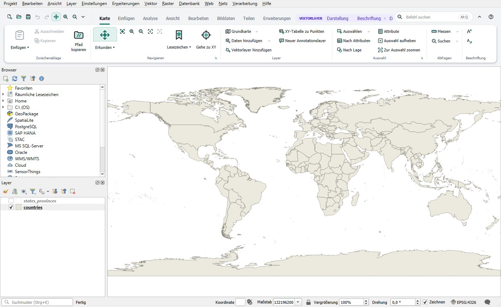

# Anleitung QGIS Ribbon

QGIS Ribbon ersetzt die Werkzeugleisten von QGIS durch ein Ribbon: Befehle geordnet in Tabs und Gruppen, Tabs, die erscheinen, wenn ein passender Layer aktiv ist, eine Schnellzugriffsleiste, Tastaturkürzel (KeyTips) und eine Befehlssuche. Menüleiste, Bedienfelder und alle Funktionen von QGIS bleiben, wie sie sind. Das Ribbon ruft nur vorhandene QGIS-Funktionen auf.

## Inhalt

1. [Mit dem Ribbon arbeiten](ribbon.md): Tabs, Kontext-Tabs, Buttons, Menüs, Galerien, Schnellzugriff, Minimieren
2. [Tastatur: Kürzel und Suche](keyboard.md): Alt, Alt und Q, eigene Kürzel
3. [Ribbon anpassen](customize.md): der Editor, Galerien, Anordnungen
4. [Darstellung](appearance.md): hell und dunkel, Akzentfarben, Icons, klassische QGIS-Oberfläche
5. [Erweiterungen](extensions.md): Befehle von Plugins, eigene Skripte und Modelle
6. [Weitere Werkzeuge](tools.md): Domänen und andere Befehle des Ribbons
7. [Einstellungen, Zurücksetzen und Probleme](troubleshooting.md)

## Diese Anleitung öffnen

- Knopf **?** rechts in der Kopfzeile des Ribbons,
- **Ribbon-Anleitung …** im Menü ▾ der Schnellzugriffsleiste oder im Rechtsklick-Menü des Ribbons,
- **Hilfe › Erweiterungen › Anleitung QGIS Ribbon** in der Menüleiste von QGIS,
- Knopf **Hilfe** (im Editor auch F1) in den Dialogen des Ribbons.

**Online öffnen** zeigt die aktuelle Seite auf GitHub im Webbrowser.

## Sprache

Das Ribbon gibt es auf Deutsch und Englisch. Es folgt der Sprache von QGIS (**Einstellungen › Optionen › Allgemein › Systemgebietsschema überschreiben**). Nach einem Wechsel der Sprache QGIS neu starten.

## Hinweis

QGIS Ribbon folgt dem Ribbon-Bedienkonzept von ArcGIS Pro, damit sich Umsteiger in QGIS schnell zurechtfinden. Es ist ein unabhängiges Projekt, nicht mit Esri verbunden und nicht von Esri unterstützt. Es enthält keine Icons, Texte oder Grafiken von Esri.
