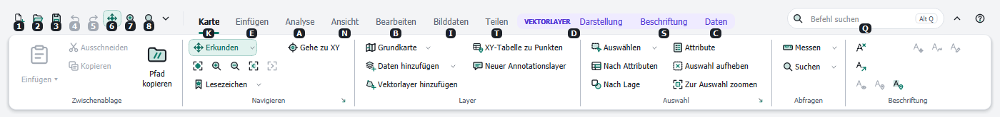
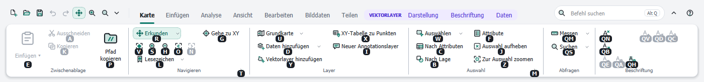
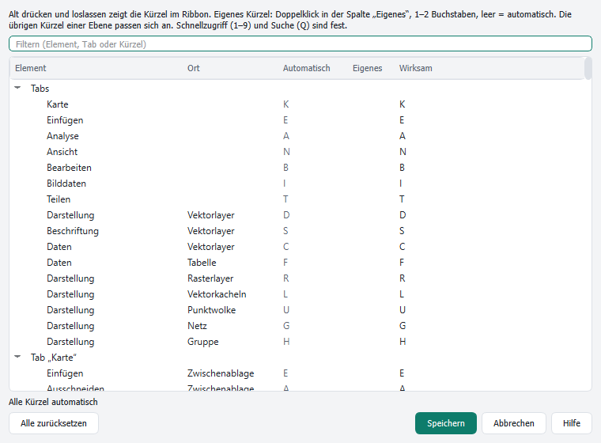
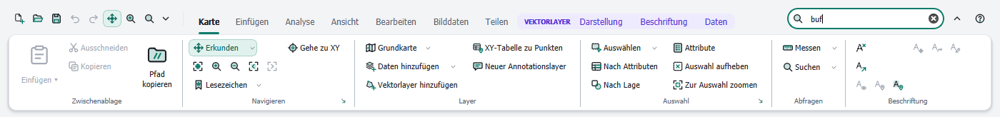

# Tastatur: Kürzel und Suche

[Inhalt](index.md)

## Kürzel (KeyTips)

Jeder Tab und jeder Befehl im Ribbon hat ein Kürzel: ein oder zwei Buchstaben, mit denen er sich per Tastatur auslösen lässt.

1. **Alt** drücken und loslassen (ohne andere Taste dazwischen). Buchstaben erscheinen an den Tabs, Ziffern an der Schnellzugriffsleiste und **Q** am Suchfeld.

   

2. Den Buchstaben eines Tabs tippen. Der Tab öffnet sich und zeigt die Kürzel seiner Befehle.

   

3. Das Kürzel eines Befehls tippen. Buttons werden ausgeführt, Menüs öffnen sich, Felder wie Maßstab oder Schrift bekommen den Tastaturfokus.

| Taste | Wirkung |
|---|---|
| Alt (drücken und loslassen) | Kürzel zeigen oder wieder ausblenden |
| 1 – 9 | Befehl der Schnellzugriffsleiste |
| Q | Befehlssuche |
| Esc | eine Ebene zurück |
| Rücktaste | letzten Buchstaben eines zweistelligen Kürzels löschen |
| Mausklick, anderes Fenster | Kürzel beenden |

Alt zusammen mit einem Buchstaben (zum Beispiel Alt+P) öffnet wie gewohnt die Menüs von QGIS. Eingeklappte Gruppen in einem schmalen Fenster bekommen ein eigenes Kürzel, das die Gruppe öffnet; die Kürzel der Befehle bleiben dieselben.

## Kürzel anpassen

**Kürzel anpassen …** im Menü ▾ der Schnellzugriffsleiste oder im Rechtsklick-Menü öffnet eine Liste aller Kürzel.

- **Filter** findet Einträge nach Name, Tab oder Kürzel.
- Doppelklick in die Spalte **Eigenes** und ein oder zwei Buchstaben eingeben. Leer lassen bedeutet wieder automatisch.
- Die übrigen Kürzel derselben Ebene passen sich an. Konflikte stehen unter der Liste.
- **Alle zurücksetzen** entfernt alle eigenen Kürzel.
- Schnellzugriff (1–9) und Suche (Q) sind fest.

Eigene Kürzel gehören zur Anordnung, siehe [Ribbon anpassen](customize.md).

## Befehlssuche

Das Feld **Befehl suchen** rechts in der Kopfzeile findet Befehle nach Name, Beschreibung oder Ort im Ribbon, dazu Befehle aus den Menüs von QGIS, die nicht im Ribbon stehen.

- Öffnen: in das Feld klicken, oder **Alt**, dann **Q**.
- Jeder Treffer zeigt, wo der Befehl steht (zum Beispiel *Analyse › Werkzeuge*). Befehle aus den QGIS-Menüs sind mit *QGIS:* gekennzeichnet, Befehle ohne Platz im Ribbon (etwa **Eigenschaften: Metadaten** oder **Projekteigenschaften: KBS**) mit *Befehlsvorrat*. Ein QGIS-Untermenü wie **Zuletzt verwendet** öffnet sich unter dem Suchfeld.
- **Eingabe** führt den ersten Treffer aus, die Pfeiltasten wählen einen anderen.
- **Esc** leert das Feld und kehrt zur Karte zurück.
- Groß- und Kleinschreibung spielen keine Rolle. Umlaute lassen sich als ae, oe, ue und ss eingeben.

## Weitere Tasten

| Taste | Wirkung |
|---|---|
| Strg+F1 | Ribbon minimieren oder wieder zeigen |
| F1 im Editor | diese Anleitung |

Die Tastenkürzel von QGIS (zum Beispiel Strg+S, Strg+Z) gelten weiter. Die Tooltips im Ribbon zeigen das Tastenkürzel eines Befehls.
