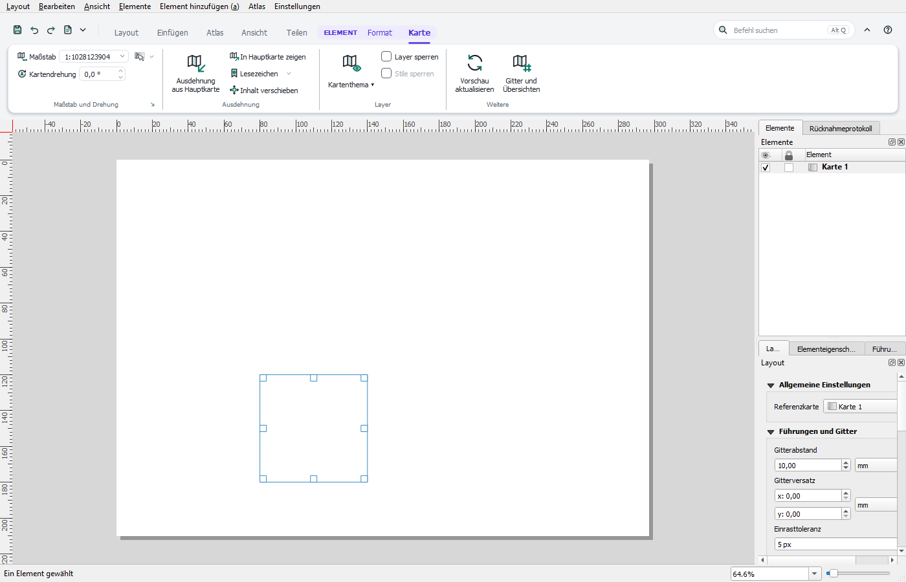
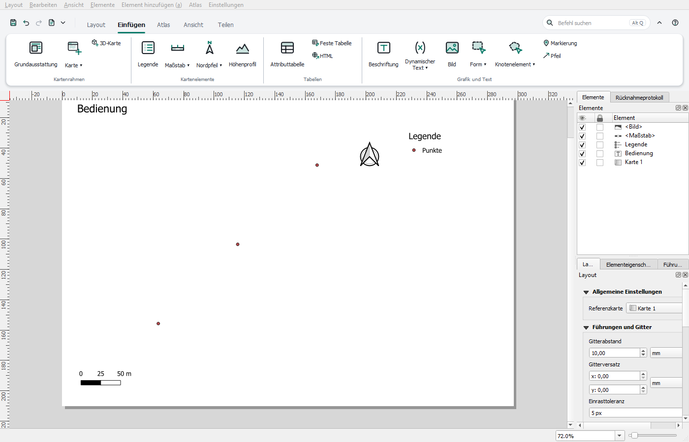
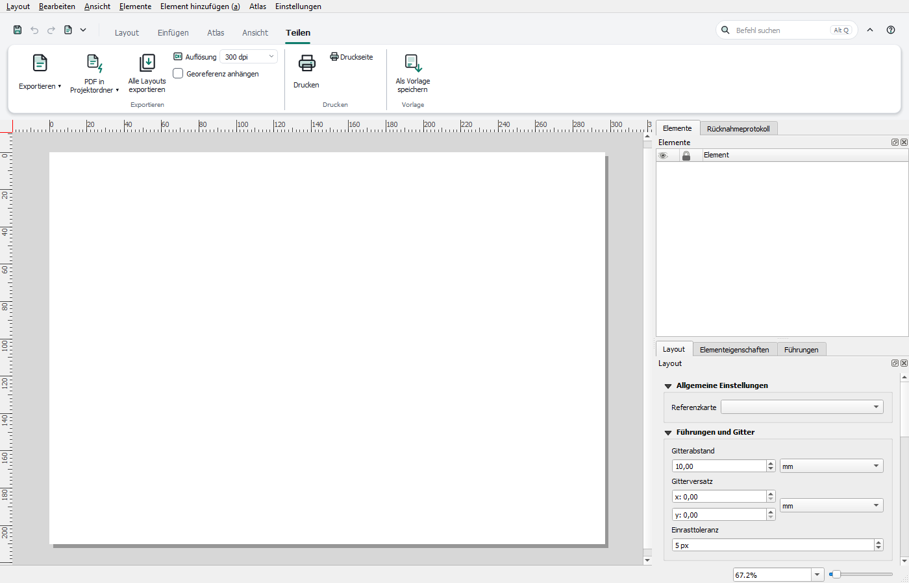
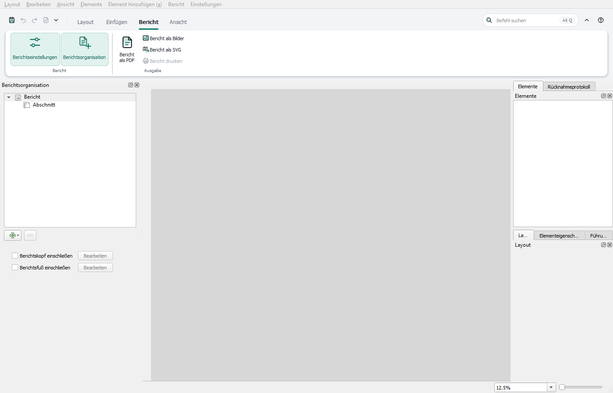

# Ribbon im Layout-Fenster

Auch das Fenster für Drucklayouts und Berichte hat ein Ribbon. Es ersetzt dort die Werkzeugleisten von QGIS; Menüleiste und Bedienfelder bleiben. Jedes geöffnete Fenster hat sein eigenes Ribbon, und beim Schließen stellt es das Fenster wieder so her, wie QGIS es kennt.

## Tabs

- **Layout:** Zwischenablage, Auswahl, Seite, Navigieren und Layout (neu anlegen, öffnen, verwalten).
- **Einfügen:** Karten, Legende, Maßstab, Tabellen, Text, Bilder und Formen.
- **Atlas:** Einstellungen, Vorschau, Blättern und Ausgabe. Das Feld **Objekt** springt während der Vorschau direkt zu einem Objekt.
- **Bericht:** nur bei Berichten, siehe unten.
- **Ansicht:** Bedienfelder, Lineale, Gitter, Führungslinien, Einrasten, Vorschau und Fenster.
- **Teilen:** Export als PDF, Bild oder SVG, Drucken und als Vorlage speichern.
- **Erweiterungen:** nur, wenn Plugins eigene Befehle in die Leisten des Fensters legen.

## Tabs für das gewählte Element

Sobald Elemente gewählt sind, erscheint der Tab **Format** mit Anordnen, Ausrichten, Größe und Position, Rahmen, Hintergrund und Darstellung. Bei mehreren Elementen gelten die Werte für alle.

Bei genau einem Element kommt ein Tab für seine Art dazu: **Karte**, **Text**, **Legende**, **Maßstab**, **Bild**, **Form** oder **Tabelle**. Das Bedienfeld **Elementeigenschaften** zieht mit, und jede Änderung lässt sich mit **Rückgängig** zurücknehmen. Was nicht auf dem Tab liegt, öffnet der kleine Pfeil unten an der Gruppe im Bedienfeld.

## Neue Layouts und Seiten

- **Layout › Neues Layout:** Das Menü am Knopf legt das Layout gleich mit A4 oder A3 an, quer oder hoch.
- **Layout › Neues Layout › Layout aus Vorlage:** Die Liste zeigt die Vorlagen (.qpt) aus den Vorlagenordnern von QGIS, **Vorlagendatei wählen …** jede andere Datei. Das neue Layout öffnet sich im eigenen Fenster. Im Hauptfenster steht derselbe Knopf unter **Teilen**.
- **Layout › Verwalten:** **Aus Vorlage einfügen** holt die Elemente einer Vorlage in das aktuelle Layout. Dazu Duplizieren, Umbenennen, Löschen, die Layoutverwaltung und die Layouteigenschaften.
- **Layout › Seitengröße:** A4 bis A0, quer oder hoch, für die gezeigte Seite. Die Elemente bleiben auf der Seite an ihrem Platz.
- **Ausrichtung** tauscht Hoch- und Querformat der gezeigten Seite, **Seite löschen** löscht sie (die letzte Seite eines Layouts bleibt), **Ränder als Führungen** legt vier Führungslinien im Abstand von 5 bis 20 mm zu den Rändern der Seite. **Zu Seite** zeigt bei mehreren Seiten eine Seite ganz. Jeder dieser Befehle ist ein Schritt für **Rückgängig**. Die Seiteneigenschaften öffnet der kleine Pfeil unten an der Gruppe Seite.

Die Schnellzugriffsleiste bietet Speichern, Rückgängig, Wiederholen und den Export als PDF.

## Elemente fertig einfügen

Im Tab **Einfügen** kommen Karte, Maßstab und Nordpfeil fertig eingestellt aufs Blatt. Ein Klick auf den Knopf zieht das Element wie bisher mit der Maus auf; das Menü darunter bietet zuerst dasselbe (**… aufziehen**) und danach die Auswahl:

- **Karte:** **Aktuelle Kartenansicht**, jedes Kartenthema des Projekts (die Karte folgt dem Thema) und jedes Lesezeichen. Auf einer Seite ohne Karte füllt die neue Karte die Seite bis 10 mm vor den Rand.
- **Maßstab:** jeder Stil von QGIS. Der Maßstab ist mit der Karte verknüpft und steht unten links unter ihr; reicht dort der Platz nicht, unten links in der Karte.
- **Nordpfeil:** die Nordpfeile von QGIS. Der Pfeil ist mit der Karte verknüpft, dreht sich mit ihr und steht 20 × 20 mm groß oben rechts in der Karte.

Bezug ist die Referenzkarte des Layouts (Layouteigenschaften), sonst die erste Karte. Ohne Karte sind Maßstab und Nordpfeil im Menü grau. **Grundausstattung** legt an, was der Seite fehlt: Titel (Projekttitel, sonst Name des Layouts), Karte, Legende, Maßstab und Nordpfeil, angeordnet nach Größe und Ausrichtung der Seite. Eine vorhandene Karte bleibt. Jedes Einfügen ist ein Schritt für **Rückgängig**; das neue Element ist danach gewählt.

## Exportieren und Atlas

- **Teilen › Exportieren:** Der Knopf exportiert als PDF, sein Menü als Bild oder SVG. **Auflösung** setzt die Exportauflösung des Layouts (96 bis 600 dpi oder eine eigene Zahl), **Georeferenz anhängen** speichert neben exportierten Bildern ein Worldfile.
- **PDF in Projektordner** exportiert ohne Dialog nach `<Ordner>/<Name des Layouts>.pdf`. Den Ordner fragt der Ribbon beim ersten Mal und merkt ihn sich im Projekt; das Menü am Knopf wählt einen anderen. Gibt es die Datei schon, fragt er vor dem Überschreiben; das lässt sich für das Projekt abschalten. Die Meldung oben im Fenster verweist auf die Datei.
- **Alle Layouts exportieren** zeigt die Layouts des Projekts zum Abhaken, das Format (PDF oder PNG) und den Ordner. Ein Layout mit Atlas wird ein PDF, als PNG ein Ordner mit einem Bild je Objekt. Denselben Knopf gibt es im Hauptfenster unter **Teilen**.
- **Atlas:** **Atlas aus aktivem Layer** nimmt den aktiven Layer des Hauptfensters, lässt die Karte dem Atlas folgen (Rand 10 %) und zeigt die Vorschau. Abdeckungslayer (leer schaltet den Atlas aus), Seitenname, Filter und Sortierung stehen als Felder im Ribbon und folgen dem Bedienfeld Atlas.
- **Format › Format kopieren** merkt sich Rahmen, Hintergrund, Deckkraft und Mischmodus des gewählten Elements, bei Text auch Schrift, Farbe und Ausrichtung. **Format einfügen** überträgt das auf alle gewählten Elemente (Texteinstellungen nur auf Texte), als ein Schritt für **Rückgängig**.

## Berichte

Bei einem Bericht entfallen die Tabs Atlas und Teilen. Dafür gibt es den Tab **Bericht** mit den Einstellungen, dem Bedienfeld **Berichtsorganisation** und der Ausgabe als PDF, Bild oder SVG sowie dem Drucken.

Die Tabs Layout, Einfügen und die Tabs für das gewählte Element arbeiten mit dem Abschnitt, den Sie gerade bearbeiten. Solange kein Abschnitt gewählt ist, sind die Befehle der Gruppe Seite und die Grundausstattung grau.

## Tastatur und Suche

**Alt** zeigt die Kürzel, **Alt** und **Q** führt in die Suche, wie im [Hauptfenster](keyboard.md). Die Suche findet die Befehle des Layout-Ribbons und die übrigen Aktionen dieses Fensters.

## Anpassen

Rechtsklick, Menü ▾ und Editor funktionieren wie im Hauptfenster, siehe [Ribbon anpassen](customize.md). Tabs, Gruppen, Schnellzugriff und Kürzel gelten getrennt je Fensterart: Der Editor im Layout-Fenster ändert nur das Layout-Fenster. Eine gespeicherte **Anordnung** und eine exportierte Datei enthalten dagegen beide Fenster.

## Was für beide Fenster gilt

**Design**, **Kontur für ganz QGIS**, **QGIS-Menüleiste ausblenden** und die **klassische QGIS-Oberfläche** gelten für alle Fenster gleich. Die klassische Oberfläche stellt auch die Leisten im Layout-Fenster wieder her.

## Ribbon im Layout-Fenster abschalten

Im Menü ▾ der Schnellzugriffsleiste oder im Rechtsklick-Menü steht **Ribbon im Layout-Fenster**. Ist es aus, zeigt das Layout-Fenster die Leisten von QGIS, das Hauptfenster behält sein Ribbon. Der Schalter wirkt sofort, auch bei offenen Fenstern.

Eigene Werkzeugleisten von Plugins bleiben im Layout-Fenster sichtbar, als zweite Zeile unter dem Ribbon.
