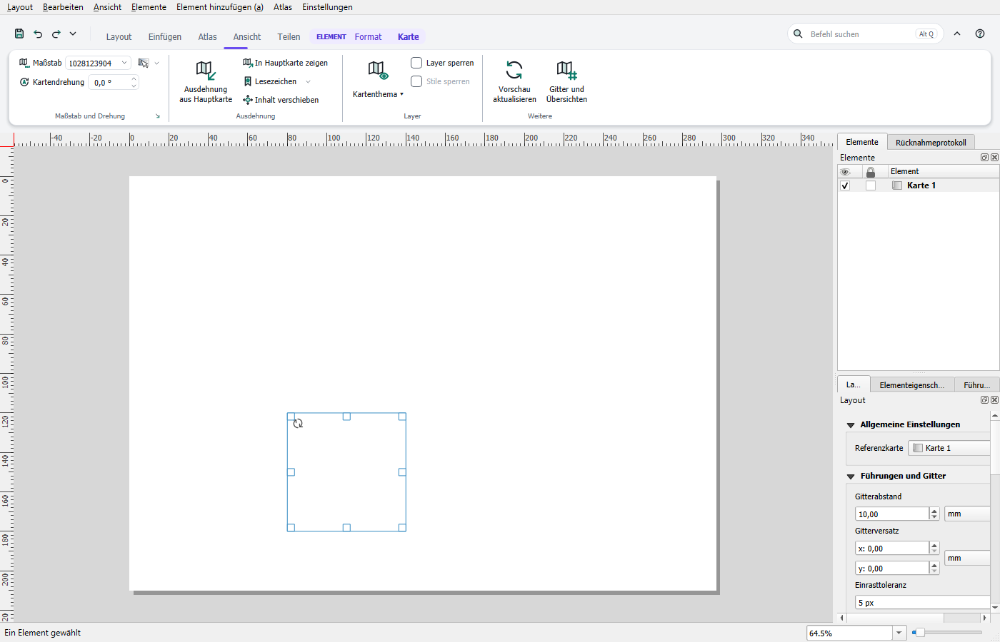
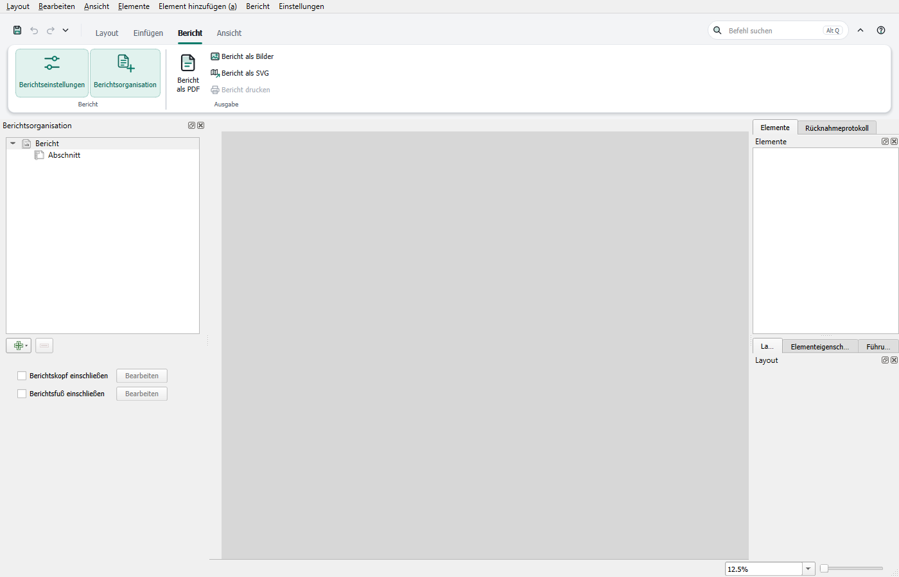

# Ribbon im Layout-Fenster

Auch das Fenster für Drucklayouts und Berichte hat ein Ribbon. Es ersetzt dort die Werkzeugleisten von QGIS; Menüleiste und Bedienfelder bleiben. Jedes geöffnete Fenster hat sein eigenes Ribbon, und beim Schließen stellt es das Fenster wieder so her, wie QGIS es kennt.

## Tabs

- **Layout:** Zwischenablage, Navigieren, Auswahl, Seite und das Verwalten der Layouts.
- **Einfügen:** neues Layout, Vorlagen, Karten, Legende, Maßstab, Tabellen, Text, Bilder und Formen.
- **Atlas:** Einstellungen, Vorschau, Blättern und Ausgabe. Das Feld **Objekt** springt während der Vorschau direkt zu einem Objekt.
- **Bericht:** nur bei Berichten, siehe unten.
- **Ansicht:** Bedienfelder, Lineale, Gitter, Führungslinien, Einrasten, Vorschau und Fenster.
- **Teilen:** Export als PDF, Bild oder SVG, Drucken und als Vorlage speichern.
- **Erweiterungen:** nur, wenn Plugins eigene Befehle in die Leisten des Fensters legen.

## Tabs für das gewählte Element

Sobald Elemente gewählt sind, erscheint der Tab **Format** mit Anordnen, Ausrichten, Größe und Position, Rahmen, Hintergrund und Darstellung. Bei mehreren Elementen gelten die Werte für alle.

Bei genau einem Element kommt ein Tab für seine Art dazu: **Karte**, **Text**, **Legende**, **Maßstab**, **Bild**, **Form** oder **Tabelle**. Das Bedienfeld **Elementeigenschaften** zieht mit, und jede Änderung lässt sich mit **Rückgängig** zurücknehmen. Was nicht auf dem Tab liegt, öffnet der kleine Pfeil unten an der Gruppe im Bedienfeld.

## Neue Layouts und Seitengrößen

- **Einfügen › Neues Layout:** Das Menü am Knopf legt das Layout gleich mit A4 oder A3 an, quer oder hoch.
- **Einfügen › Layout aus Vorlage:** Die Liste zeigt die Vorlagen (.qpt) aus den Vorlagenordnern von QGIS, **Vorlagendatei wählen …** jede andere Datei. Das neue Layout öffnet sich im eigenen Fenster. Im Hauptfenster steht derselbe Knopf unter **Teilen**.
- **Einfügen › Aus Vorlage einfügen** holt dagegen die Elemente einer Vorlage in das aktuelle Layout.
- **Layout › Seitengröße:** A4 bis A0, quer oder hoch, für die gezeigte Seite. Die Elemente bleiben auf der Seite an ihrem Platz.

## Berichte

Bei einem Bericht entfallen die Tabs Atlas und Teilen. Dafür gibt es den Tab **Bericht** mit den Einstellungen, dem Bedienfeld **Berichtsorganisation** und der Ausgabe als PDF, Bild oder SVG sowie dem Drucken.

Die Tabs Layout, Einfügen und die Tabs für das gewählte Element arbeiten mit dem Abschnitt, den Sie gerade bearbeiten.

## Tastatur und Suche

**Alt** zeigt die Kürzel, **Alt** und **Q** führt in die Suche, wie im [Hauptfenster](keyboard.md). Die Suche findet die Befehle des Layout-Ribbons und die übrigen Aktionen dieses Fensters.

## Anpassen

Rechtsklick, Menü ▾ und Editor funktionieren wie im Hauptfenster, siehe [Ribbon anpassen](customize.md). Tabs, Gruppen, Schnellzugriff und Kürzel gelten getrennt je Fensterart: Der Editor im Layout-Fenster ändert nur das Layout-Fenster. Eine gespeicherte **Anordnung** und eine exportierte Datei enthalten dagegen beide Fenster.

## Was für beide Fenster gilt

**Design**, **Kontur für ganz QGIS**, **QGIS-Menüleiste ausblenden** und die **klassische QGIS-Oberfläche** gelten für alle Fenster gleich. Die klassische Oberfläche stellt auch die Leisten im Layout-Fenster wieder her.

## Ribbon im Layout-Fenster abschalten

Im Menü ▾ der Schnellzugriffsleiste oder im Rechtsklick-Menü steht **Ribbon im Layout-Fenster**. Ist es aus, zeigt das Layout-Fenster die Leisten von QGIS, das Hauptfenster behält sein Ribbon. Der Schalter wirkt sofort, auch bei offenen Fenstern.

Eigene Werkzeugleisten von Plugins bleiben im Layout-Fenster sichtbar, als zweite Zeile unter dem Ribbon.
