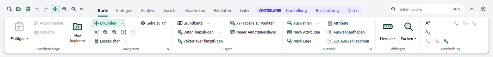
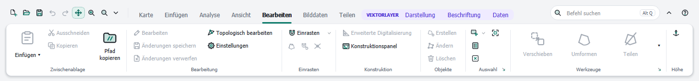
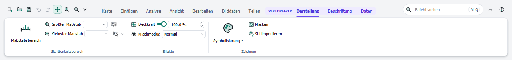
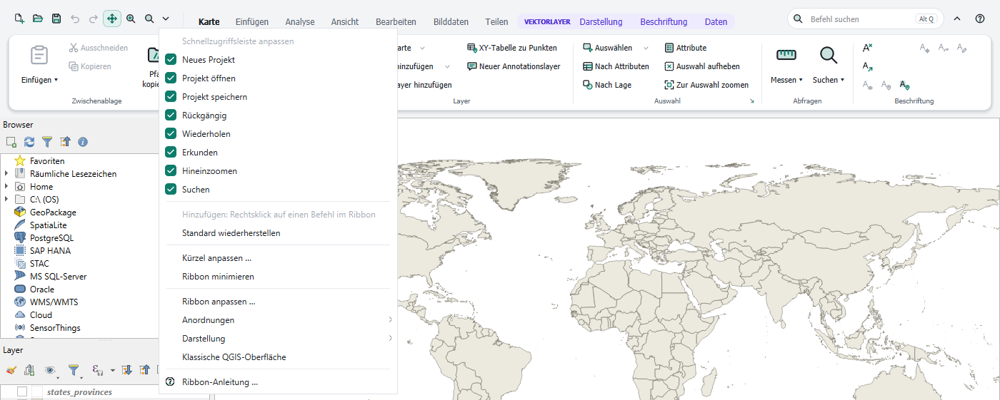
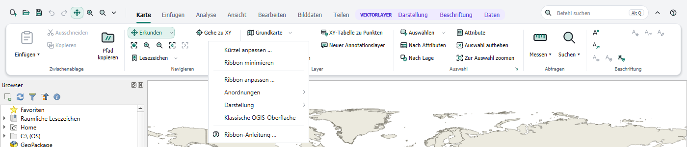
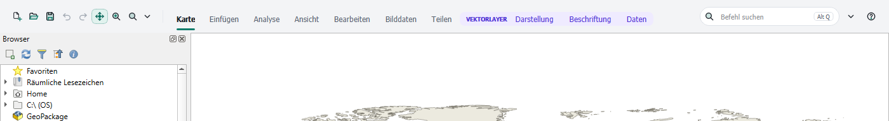

# Mit dem Ribbon arbeiten

[Inhalt](index.md)

Das Ribbon besteht aus der **Kopfzeile** (Schnellzugriffsleiste, Tabs, Befehlssuche, Knöpfe zum Minimieren und für die Hilfe) und der **Ribbon-Fläche** mit den Gruppen des gewählten Tabs.

## Tabs

| Tab | Gruppen |
|---|---|
| Karte | Zwischenablage, Navigieren, Layer, Auswahl, Abfragen, Beschriftung |
| Einfügen | Projekt, Neue Layer, Stile, Favoriten |
| Analyse | Geoverarbeitung, Werkzeuge |
| Ansicht | Verknüpfen, Fenster, Barrierefreiheit, Navigation |
| Bearbeiten | Zwischenablage, Bearbeitung, Einrasten, Konstruktion, Objekte, Auswahl, Werkzeuge, Höhe |
| Bilddaten | Ausrichten, Analyse |
| Teilen | Paket, Speichern als, Ausgabe |
| Erweiterungen | Befehle installierter Plugins, siehe [Erweiterungen](extensions.md) |

Beginnt die Bearbeitung eines Layers, wechselt das Ribbon zum Tab **Bearbeiten**.

**Konstruktion › Erweiterte Digitalisierung** schaltet die Konstruktionshilfen ein oder aus (Abstand, Winkel, Koordinaten beim Digitalisieren). Der Schalter ist bedienbar, solange ein Werkzeug aktiv ist, das sie unterstützt, etwa **Erstellen** oder **Ändern**. Solange er an ist, öffnet QGIS das Panel bei jedem solchen Werkzeug; **Konstruktionspanel** blendet es ein oder aus. Die kleinen Icons in **Einrasten** schalten Spurverfolgung, Selbsteinrasten und das Einrasten auf Schnittpunkte.

## Kontext-Tabs

Manche Tabs erscheinen nur, wenn sie zum aktiven Layer im Bedienfeld Layer passen. Sie stehen rechts in einem farbigen Rahmen mit dem Namen ihres Kontexts:

- **Vektorlayer:** Darstellung, Beschriftung, Daten
- **Tabelle** (Layer ohne Geometrie): Daten
- **Rasterlayer:** Darstellung

Befehle, die gerade nicht anwendbar sind (zum Beispiel *Auswahl aufheben* ohne Auswahl), sind ausgegraut.

## Buttons, Menüs und Galerien

- **Große, mittlere und kleine Buttons** führen einen Befehl aus. Buttons, die etwas ein- oder ausschalten (zum Beispiel ein Kartenwerkzeug), bleiben hervorgehoben, solange sie aktiv sind.
- **Split-Buttons** haben zwei Teile: Der obere oder linke Teil führt den Hauptbefehl aus, der Pfeil ▾ öffnet verwandte Befehle.
- **Menüs** (Beschriftung mit ▾) öffnen eine Liste von Befehlen.
- **Galerien** zeigen eine Auswahl von Werkzeugen oder Stilen (zum Beispiel die Geoverarbeitungswerkzeuge im Tab Analyse). Der Pfeil an der Seite zeigt alle Einträge. Welche Einträge erscheinen, lässt sich ändern, siehe [Ribbon anpassen](customize.md).
- **Steuerelemente** wie Felder für Maßstab, Deckkraft oder Schrift wirken direkt auf den aktiven Layer.
- **Dialog-Launcher:** Der kleine Pfeil ↘ rechts unten in einer Gruppe öffnet den passenden QGIS-Dialog mit weiteren Einstellungen.
- **Tooltips** zeigen Name, Beschreibung und Tastenkürzel eines Befehls.

Ist das Fenster schmal, klappen Gruppen von rechts zu einem einzelnen Button zusammen. Ein Klick darauf zeigt die Gruppe als Ausklappliste.

## Schnellzugriffsleiste

Die kleinen Icons links in der Kopfzeile bilden die **Schnellzugriffsleiste**. Ihre Befehle sind in jedem Tab erreichbar.

- **Befehl hinzufügen:** Rechtsklick auf einen Befehl im Ribbon, dann **Zur Schnellzugriffsleiste hinzufügen**.
- **Befehl entfernen:** im Menü ▾ das Häkchen entfernen, oder Rechtsklick darauf und **Aus Schnellzugriffsleiste entfernen**.
- **Reihenfolge:** im Editor, siehe [Ribbon anpassen](customize.md).
- **Standard wiederherstellen** im Menü ▾ stellt die gelieferten Befehle wieder her.

Das Menü ▾ enthält außerdem die Einstellungen des Ribbons: Kürzel, Minimieren, Editor, Anordnungen, Darstellung, klassische QGIS-Oberfläche und diese Anleitung. Dieselben Einträge stehen im Rechtsklick-Menü des Ribbons:

## Ribbon minimieren

Das Ribbon lässt sich auf seine Kopfzeile verkleinern, damit die Karte mehr Platz hat:

- Knopf **^** rechts in der Kopfzeile,
- **Strg+F1**,
- Doppelklick auf einen Tab,
- **Ribbon minimieren** im Menü ▾ oder im Rechtsklick-Menü.

Im minimierten Zustand zeigt ein Klick auf einen Tab das Ribbon über der Karte. Ein Klick daneben schließt es wieder. Dauerhaft zeigt man es mit dem Knopf zum Anheften, mit Strg+F1 oder mit einem erneuten Doppelklick auf einen Tab. Der Zustand bleibt für den nächsten Start erhalten.

## Befehlssuche

Das Suchfeld rechts in der Kopfzeile findet Befehle nach Name oder Beschreibung, siehe [Tastatur: Kürzel und Suche](keyboard.md).
