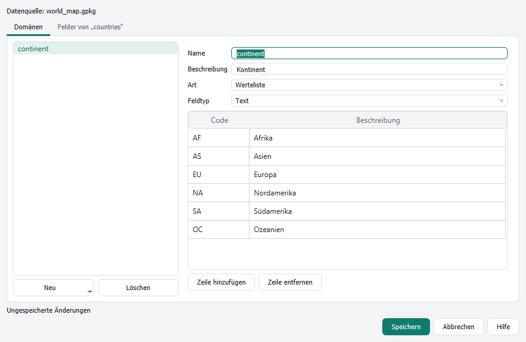

# Weitere Werkzeuge

[Inhalt](index.md)

Die meisten Befehle des Ribbons rufen vorhandene QGIS-Funktionen auf. Wo QGIS keinen passenden einzelnen Befehl hat, bringt das Ribbon einen eigenen mit. Die [Befehlssuche](keyboard.md) findet sie wie alle anderen Befehle.

## Domänen

**Domänen** (Kontext-Tab **Daten** eines Vektorlayers oder einer Tabelle, Gruppe **Datenentwurf**) verwaltet Attributdomänen: Listen erlaubter Werte (codierte Werte) oder Wertebereiche, und die Felder, für die sie gelten.

- Reiter **Domänen**: **Neu** legt eine Domäne mit codierten Werten oder einem Bereich an. Name, Beschreibung, Art und Feldtyp eintragen. Bei codierten Werten Zeilen mit Code und Beschreibung hinzufügen.
- Reiter **Felder von …**: jedem Feld des Layers eine Domäne zuordnen.
- **Speichern** schreibt die Domänen. In einem GeoPackage oder einer anderen Datenquelle, die Felddomänen kennt, liegen sie dort, sonst im QGIS-Projekt.
- Im Attributformular bekommen die Felder eine passende Auswahlliste oder Bereichsprüfung.

Probleme wie Werte, die nicht zum Feldtyp passen, stehen unter der Liste; Speichern geht erst, wenn sie behoben sind.

## Weitere eigene Befehle

| Befehl | Ort | Wirkung |
|---|---|---|
| Pfad kopieren | Karte › Zwischenablage | kopiert den Pfad der Datenquelle des aktiven Layers |
| Grundkarte | Karte › Layer | fügt eine Grundkarte hinzu (zum Beispiel OpenTopoMap) |
| Lesezeichen | Karte › Navigieren | räumliche Lesezeichen als Galerie |
| Auswahl per Linie | Karte › Auswahl | wählt Objekte, die eine gezeichnete Linie kreuzt |
| Suchen | Karte › Abfragen | setzt den Fokus in die Suchleiste von QGIS |
| Drehung, Lupe | Ansicht › Navigation | Drehung und Vergrößerung der Karte |
| Maßstabsbereich, Deckkraft, Mischmodus | Vektorlayer › Darstellung | Einstellungen des aktiven Layers |
| Steuerelemente der Beschriftung | Vektorlayer › Beschriftung | Feld, Schrift, Größe, Farbe und Platzierung der Beschriftung |
| Helligkeit, Kontrast, Gamma, Kanalkombination | Rasterlayer › Darstellung | Anzeige des aktiven Rasters |
