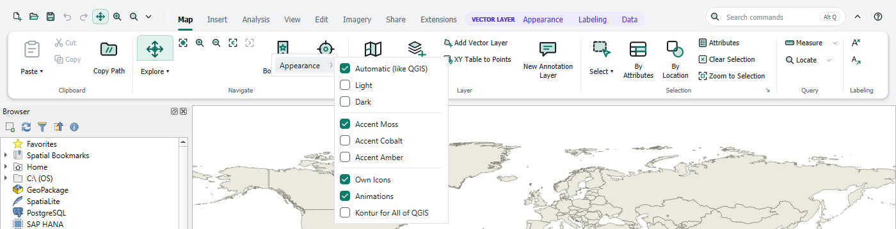
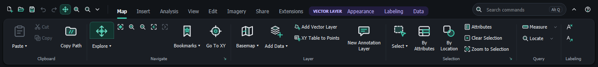

# Appearance

[Contents](index.md)

The submenu **Appearance** in the ▾ menu of the Quick Access Toolbar and in the right-click menu of the ribbon controls the look. Changes apply immediately.

| Entry | Effect |
|---|---|
| Automatic (like QGIS) | light or dark, following the QGIS theme |
| Light, Dark | fixed mode |
| Accent Moss, Cobalt, Amber | color of the selected tab, highlights and buttons |
| Own Icons | the icons of the ribbon; switched off, the ribbon uses the QGIS icons |
| Animations | short transitions, for example when switching tabs |
| Kontur for All of QGIS | panels, layer tree, menu bar and status bar in the same style as the ribbon |

With **Kontur for All of QGIS** the whole window follows the ribbon:

Switching it off restores the previous QGIS style exactly. In the Windows high-contrast mode the ribbon uses the system colors.

## Classic QGIS interface

**Classic QGIS Interface** in the ▾ menu or the right-click menu removes the ribbon and brings back the QGIS toolbars as they were. QGIS remembers this choice for the next start.

To return to the ribbon, choose **View › Ribbon Interface** in the QGIS menu bar.

Deactivating or uninstalling the plugin also restores the QGIS toolbars and the window layout.
