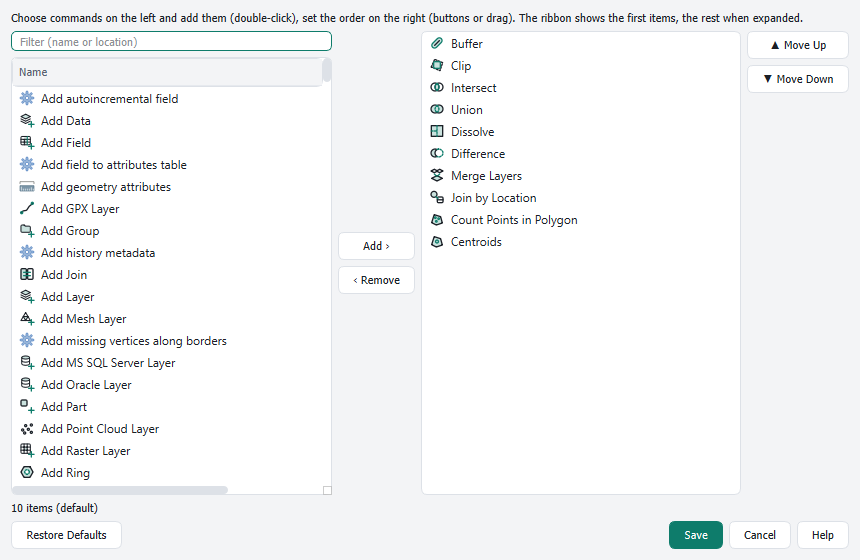

# Customizing the ribbon

[Contents](index.md)

Everything in the ribbon can be changed: hide, delete, rename or reorder tabs and groups, put commands into any group, create your own tabs and groups, and choose the commands of the Quick Access Toolbar and of the galleries. A set of these changes is called an **arrangement**.

## The editor

**Customize Ribbon …** in the ▾ menu of the Quick Access Toolbar or in the right-click menu of the ribbon opens the editor. It looks like the ribbon itself.

- **Top:** the tabs. Contextual tabs are on the right and marked with their color.
- **Quick Access:** the commands of the Quick Access Toolbar.
- **Middle:** a preview of the selected tab with its groups.
- **Bottom left:** the commands. **Search** finds them by name or description. The list next to it filters: *All*, *Not in the ribbon*, *Extensions (plugins)*, *Own scripts and models*, *Toolbox (all tools)* or one tab. *Not in the ribbon* also lists further QGIS commands that have no place in the shipped ribbon, for example Zoom Out, Refresh, Temporal Controller, Duplicate Layer, Close Project, Keyboard Shortcuts, the pages of the layer properties (**Properties: …**), of the project properties and of the options (**Options: …**), **Manage and Install Plugins**, the decorations, the help commands and every menu of the QGIS menu bar as a dropdown (**Project Menu**, **Settings Menu** …, all together: **QGIS Menus**). A check mark shows that a command is already in the selected tab. **Groups** shows whole groups instead of single commands.
- **Bottom right:** the properties of the selected tab, group or command (label, visibility, size).

Nothing changes in the ribbon until you click **Save**. **Cancel** asks before discarding changes. Every step can be undone with the arrows at the top right (Ctrl+Z, Ctrl+Y). **Restore Defaults** resets tabs, groups and Quick Access to the shipped state; this can also be undone.

### What you can do

| Task | Mouse | Keyboard |
|---|---|---|
| Choose a tab | click the tab | Left/Right arrow in the tab bar |
| Add a command | drag it from the commands into a group; a marker shows the position | select a group or item, select the command, Enter |
| Move an item | drag it, also into another group; hold it over another tab to switch there | Ctrl+arrow; Ctrl+X, choose the target, Ctrl+V |
| New group | click **＋ Group**, or drop a command on it | select **＋ Group**, Enter |
| Move a group | drag its header | select the group header, Ctrl+arrow |
| Copy a group of another tab | switch the commands to **Groups** and drag the tile into the preview or onto a tab | select the tile, Enter |
| New tab | **＋ Tab** | – |
| Reorder tabs | drag the tab (main tabs stay before contextual tabs) | select the tab, Ctrl+arrow |
| Remove, delete | drag it back into the commands | Delete |
| Bring back a deleted tab | **Restore Deleted Tab** at the bottom of the window | – |
| Show or hide | eye icon on a tab or group | Space |
| Rename | double-click (your own tabs, all groups) | F2 |
| Item size | properties: large, medium, small | – |
| Quick Access | drag a command into the Quick Access row, reorder it there, drag it back to remove | Ctrl+Q in the commands, Ctrl+arrow, Delete |
| Reset one group | menu ⋯ of the group, or properties | – |
| Undo, redo | arrows at the top right | Ctrl+Z, Ctrl+Y |

Notes:

- A command can be in a group only once, but several times in the same tab.
- Contextual tabs only accept commands that can work there.
- A group of the shipped ribbon becomes your own version as soon as you change it. It is marked as *customized* and can be reset on its own.
- Split buttons, menus, galleries and rows of small buttons stay one unit. They can be moved and removed; ▾ shows their content. What a dropdown contains can be customized (see below).
- Empty groups of your own are dropped when saving.
- Tabs and groups of the shipped ribbon can be deleted, too. The editor asks before it deletes a default tab; groups are deleted without asking.
- The palette **Groups** brings back a deleted group, **Restore Deleted Tab** brings back a deleted tab with all its groups. **Restore Defaults** brings back everything.
- Contextual tabs can only be hidden, and at least one main tab always remains.
- The commands of deleted tabs and groups stay available through the search and the commands in the editor; entries in the Quick Access Toolbar stay.

## Customizing a gallery

Galleries define what a button with a selection shows, for example the geoprocessing tools in the Analysis tab, the editing tools or the basemaps in the Map tab. To customize one, right-click the gallery in the ribbon and choose **Customize Gallery “…” …**. In the editor, select the gallery and press **Customize Gallery …**; the editing and analysis tools also have the entry in their menu.

Double-click commands on the left or use **Add ›** to add them. Set the order on the right with **Move Up** and **Move Down** or by dragging. Any button can be chosen, including commands of other plugins and tools of the Toolbox. Galleries in the ribbon show the first items directly, the rest when the gallery is expanded. In galleries with a dropdown the items appear as tiles at the top of the menu; what QGIS itself provides (such as bookmarks or XYZ connections) stays below. **Restore Defaults** brings back the shipped items.

## Customize Dropdown

The dropdowns of split buttons and menus can be filled as well, for example **Advanced Digitizing** in the Edit tab. In the editor, drag a command from the palette onto the middle of a button with ▾: the button is highlighted, and on release the command goes to the end of its dropdown. A tile of a single command can be dragged in the same way; it then leaves the group. Dropped at the edge of the button, the command goes next to it as usual.

**Customize Dropdown …** in the properties of the button sets items and order, in the same dialog as for galleries. Commands of other plugins can be chosen here too. The change applies wherever the button appears and can be undone in the editor. If a plugin is missing later, its item stays greyed out until the plugin is loaded again.

## Arrangements

The submenu **Arrangements** in the ▾ menu and in the right-click menu manages your arrangements:

- The arrangement loaded or saved last is the current one; it is checked. **Save Arrangement “…”** writes changes back into it without asking. Without a current arrangement the entry reads **Save Arrangement …** and asks for a name.
- **Save Current Arrangement As …** creates a new arrangement. If the name exists already, the ribbon asks whether to overwrite it.
- Choose a saved arrangement to load it. If changes are not saved, the ribbon asks first.
- **Default Arrangement** loads the ribbon as shipped (tabs, groups, galleries, Quick Access and KeyTips).
- **Delete** removes a saved arrangement.
- **Export …** writes the current arrangement to a JSON file, for example to share it with colleagues. **Import …** loads such a file.

If an arrangement names commands that are missing in this QGIS installation (for example of a plugin that is not installed), they appear grayed out, or are skipped with a message when importing.
