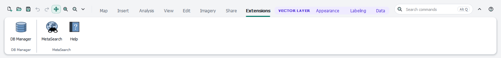

# Extensions

[Contents](index.md)

## Extensions tab

The **Extensions** tab collects the commands of installed QGIS plugins: their menu entries and toolbars, one group per plugin. It updates when plugins are installed, activated or removed. Without plugins the tab is not shown.

Plugins with their own menu in the menu bar appear here too, as do commands a plugin puts into menus or toolbars of QGIS (for example under Layer › Add Layer). Submenus of a plugin with several entries become a dropdown button; each entry can still be dragged into your own groups on its own and found in the search. The plugin decides what these dropdowns contain. If several commands of a plugin have the same text, all of them are in the tab.

While the ribbon is active, the toolbars of the plugins are hidden; their commands are in the Extensions tab. In the [classic QGIS interface](appearance.md) and after deactivating the ribbon they are back.

The groups of the Extensions tab behave like all other groups: they can be hidden, reordered and changed in the editor (see [Customizing the ribbon](customize.md)).

The layout window has this tab too, only when plugins put their own commands into its toolbars, see [Ribbon in the layout window](layout.md).

## Plugin commands in your own groups

In the editor, the filter **Extensions (plugins)** lists all plugin commands. Drag them into any group or into the Quick Access Toolbar.

If a plugin is later deactivated or removed, the ribbon hides its commands in your groups and in Quick Access. They reappear as soon as the plugin is back. To remove them for good, use **Remove Orphaned Entries …** in the editor. A reloaded plugin is picked up right away.

With many plugins the tab does not fit into the window. As in every tab, the groups then get narrower from the right, with smaller buttons and icons. Hide unused plugin groups in the editor, or put the most important commands into a tab of your own.

## Your own scripts, models and toolbox tools

Processing scripts and models of your own appear in the editor under **Own scripts and models**. **Toolbox (all tools)** lists every tool of the Processing Toolbox. Drag them into a group or a gallery like any other command.

A tool in the ribbon opens its usual Processing dialog. A deleted script or model is hidden in the ribbon until it exists again. Your own scripts without an icon of their own show a script symbol (a sheet with a run triangle) instead of the QGIS gear.
