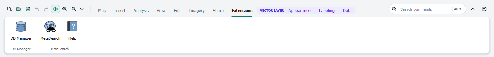

# Extensions

[Contents](index.md)

## Extensions tab

The **Extensions** tab collects the commands of installed QGIS plugins: their menu entries and toolbars, one group per plugin. It updates when plugins are installed, activated or removed. Without plugins the tab is not shown.

While the ribbon is active, the toolbars of the plugins are hidden; their commands are in the Extensions tab. In the [classic QGIS interface](appearance.md) and after deactivating the ribbon they are back.

The groups of the Extensions tab behave like all other groups: they can be hidden, reordered and changed in the editor (see [Customizing the ribbon](customize.md)).

## Plugin commands in your own groups

In the editor, the filter **Extensions (plugins)** lists all plugin commands. Drag them into any group or into the Quick Access Toolbar.

If a plugin is later deactivated or removed, its commands stay in your groups but are grayed out. They work again as soon as the plugin is back.

## Your own scripts, models and toolbox tools

Processing scripts and models of your own appear in the editor under **Own scripts and models**. **Toolbox (all tools)** lists every tool of the Processing Toolbox. Drag them into a group or a gallery like any other command.

A tool in the ribbon opens its usual Processing dialog. A deleted script or model stays grayed out in your groups until it exists again.
