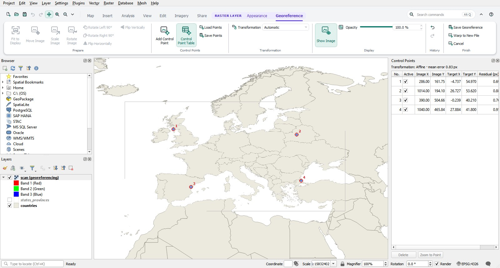
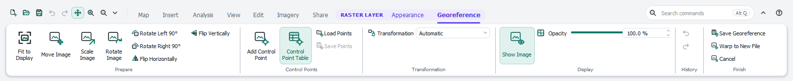

# Georeferencing in the Map

[Contents](index.md)

A scanned sheet, an aerial photo or a plan without a position can be fitted directly in the map: roughly move, scale and rotate it by hand, then place it exactly with control points. All other layers stay visible, and control points snap to their vertices and edges. The QGIS georeferencer is still available.

## Start

**Imagery › Align › Georeference** starts the session:

- If the active layer is a raster layer from an image file, the ribbon takes that image; the layer is hidden for the duration of the session.
- Otherwise it asks for an image file.

The image appears as a work layer at the top of the layer list. If it already has a georeference in the map's CRS, it lies there; otherwise it is centred in the current map view. The contextual tab **Georeference** opens. The image file itself stays unchanged until you choose **Save Georeference**.

The lower part of the button (**QGIS Georeferencer**) opens the QGIS georeferencer.

## Rough fitting

Group **Prepare**:

- **Fit to Display** centres the image in the map view.
- **Move Image**, **Scale Image** and **Rotate Image** are map tools: dragging with the mouse shows the image in its new position right away. Scaling keeps the aspect ratio; hold Shift to scale freely. When rotating, Ctrl snaps to 15° steps. Esc cancels the drag.
- **Rotate Left 90°**, **Rotate Right 90°**, **Flip Horizontally** and **Flip Vertically** turn or mirror the image around its centre.

As soon as there are control points, the ribbon computes the position from them; the tools for fitting by hand are then disabled.

## Control points

Group **Control Points**:

1. Choose **Add Control Point**.
2. Click on a spot in the image (a blue cross marks it).
3. Click on the same spot in the map. QGIS snapping applies; a red circle marks the target.

Right-click or Esc discards a half-set point. After each point the ribbon recomputes the position and shows the image there right away.

**Control Point Table** shows or hides the **Control Points** panel on the right of the window:

- image and target coordinates of each point and its residual in pixels,
- the check box in **Active** leaves a point out of the computation without deleting it,
- a selected row highlights the point in the map; **Zoom to Point** jumps there,
- **Delete** removes the selected points,
- below the table: the transformation in use and the mean error.

**Save Points** and **Load Points** use the points format of the QGIS georeferencer (`.points`). Points in another CRS are transformed to the map's CRS when loading.

## Transformation

The **Transformation** list sets how the position is computed from the control points:

| Transformation | At least | Effect |
|---|---|---|
| Automatic | 1 | 1 point translates, 2 points Helmert, 3 or more affine |
| Helmert | 2 | move, rotate, scale evenly |
| Affine | 3 | also shear and scale each axis separately |
| Polynomial 2 | 6 | curved distortions |
| Polynomial 3 | 10 | more strongly curved distortions |
| Thin Plate Spline | 1 | meets every point exactly, smooth in between |
| Projective | 4 | flat surfaces photographed at an angle |

Entries that still lack points are greyed out; the tooltip names how many are missing. Polynomials, Thin Plate Spline and Projective are shown through a warped image; with large images this takes a moment longer.

## Display and history

- **Show Image** hides and shows the image, **Opacity** makes it translucent so the map below shows through.
- **Undo** and **Redo** cover every step of the session: fitting, points, check boxes and transformation.

## Finish

- **Save Georeference** writes the position next to the image: a world file (for example `.tfw`) and the auxiliary file `.aux.xml` with the CRS. The image file itself does not change. This works for the position set by hand, translation, Helmert and affine. If the image was already loaded as a layer, that layer then shows it in the new position.
- **Warp to New File** writes the image in its current position as a new GeoTIFF. In the dialog you choose the target file, resampling, compression and target CRS. Outside the image the result stays transparent. Warping runs in the background with progress in the status bar, where it can also be cancelled. If the image was loaded as a layer, the ribbon asks whether the result should replace that layer.
- **Cancel** ends the session without saving.

## Good to know

- The work layer is never saved in the project. If you save the project during a session, it is missing there; the ribbon points this out.
- Removing the work layer, closing the project or switching to the classic interface ends the session without saving.
- Only one session runs at a time. Starting a new one ends the current one.
