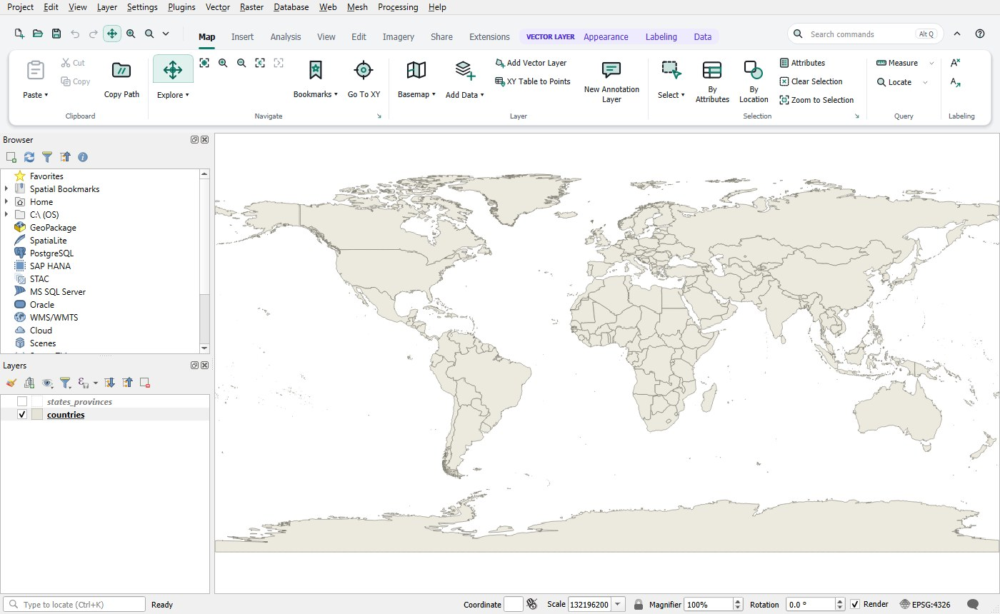

# QGIS Ribbon Guide

QGIS Ribbon replaces the QGIS toolbars with a ribbon: commands sorted into tabs and groups, tabs that appear when a layer of the matching kind is active, a Quick Access Toolbar, keyboard KeyTips and a command search. The menu bar, the panels and all QGIS functions stay as they are. The ribbon only calls existing QGIS functions.

## Contents

1. [Working with the ribbon](ribbon.md): tabs, contextual tabs, buttons, menus, galleries, Quick Access, minimizing
2. [Ribbon in the layout window](layout.md): tabs, items, templates, page sizes, reports
3. [Keyboard: KeyTips and search](keyboard.md): Alt, Alt+Q, your own KeyTips
4. [Customizing the ribbon](customize.md): the editor, galleries, arrangements
5. [Appearance](appearance.md): light and dark, accent colors, icons, the classic QGIS interface
6. [Extensions](extensions.md): plugin commands, your own scripts and models
7. [Additional tools](tools.md): domains and other commands of the ribbon
8. [Settings, reset and troubleshooting](troubleshooting.md)

## Opening this guide

- the **?** button at the right end of the ribbon header,
- **Ribbon Guide …** in the ▾ menu of the Quick Access Toolbar or in the right-click menu of the ribbon,
- **Help › Plugins › QGIS Ribbon Guide** in the QGIS menu bar,
- the **Help** button (or F1 in the editor) in the dialogs of the ribbon.

**Open Online** shows the current page on GitHub in the web browser.

## Language

The ribbon is available in English and German and follows the QGIS language (**Settings › Options › General › Override system locale**). After changing the language, restart QGIS.

## Note

QGIS Ribbon follows the ribbon concept of ArcGIS Pro so that users switching from it find their way around QGIS quickly. It is an independent project, not affiliated with or endorsed by Esri. It contains no Esri icons, texts or graphics.
