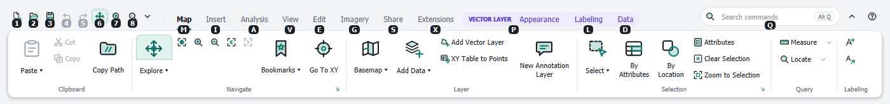
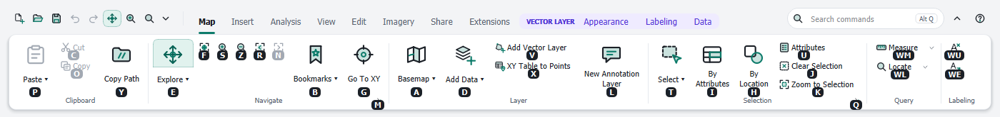
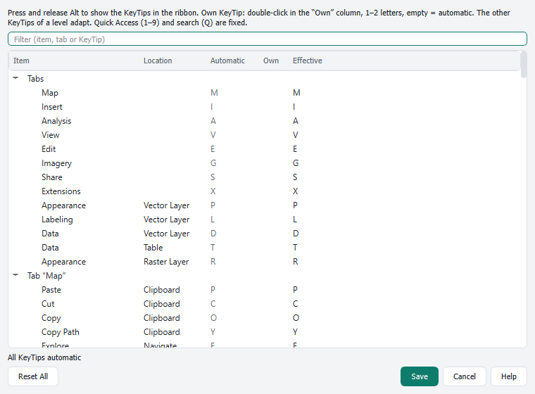
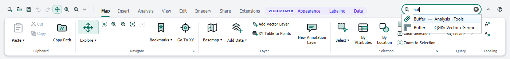

# Keyboard: KeyTips and search

[Contents](index.md)

## KeyTips

Every tab and every command in the ribbon has a KeyTip: one or two letters that run it from the keyboard.

1. Press and release **Alt** (without another key in between). Letters appear on the tabs, numbers on the Quick Access Toolbar and **Q** on the search field.

   

2. Type the letter of a tab. The tab opens and shows the KeyTips of its commands.

   

3. Type the KeyTip of a command. Buttons run, menus open, and fields such as scale or font get the keyboard focus.

| Key | Effect |
|---|---|
| Alt (press and release) | show KeyTips, or hide them again |
| 1 – 9 | command of the Quick Access Toolbar |
| Q | command search |
| Esc | back one level |
| Backspace | delete the last typed letter of a two-letter KeyTip |
| mouse click, other window | end KeyTip mode |

Alt together with a letter (for example Alt+F) still opens the QGIS menus as before. Collapsed groups in a narrow window get their own KeyTip, which opens the group; the KeyTips of the commands stay the same.

## Customizing KeyTips

**Customize KeyTips …** in the ▾ menu of the Quick Access Toolbar or in the right-click menu opens a list of all KeyTips.

- **Filter** finds items by name, tab or KeyTip.
- Double-click the **Own** column and type one or two letters. Leave it empty to use the automatic KeyTip again.
- The other KeyTips of the same level adapt automatically. Conflicts are pointed out below the list.
- **Reset All** removes all of your own KeyTips.
- Quick Access (1–9) and search (Q) are fixed.

Your own KeyTips are part of the arrangement, see [Customizing the ribbon](customize.md).

## Command search

The field **Search commands** at the right of the header finds commands by their name, description or location in the ribbon, and also commands of the QGIS menus that are not in the ribbon.

- Open: click the field, or **Alt**, then **Q**.
- Each result shows where the command is located (for example *Analysis › Tools*). Commands of the QGIS menus are marked with *QGIS:*.
- **Enter** runs the first result, the arrow keys choose another one.
- **Esc** clears the field and returns to the map.
- Upper and lower case do not matter. German umlauts can be typed as ae, oe, ue and ss.

## Other shortcuts

| Key | Effect |
|---|---|
| Ctrl+F1 | minimize the ribbon or show it again |
| F1 in the editor | this guide |

The QGIS keyboard shortcuts (for example Ctrl+S, Ctrl+Z) keep working. Tooltips in the ribbon show the shortcut of a command.
