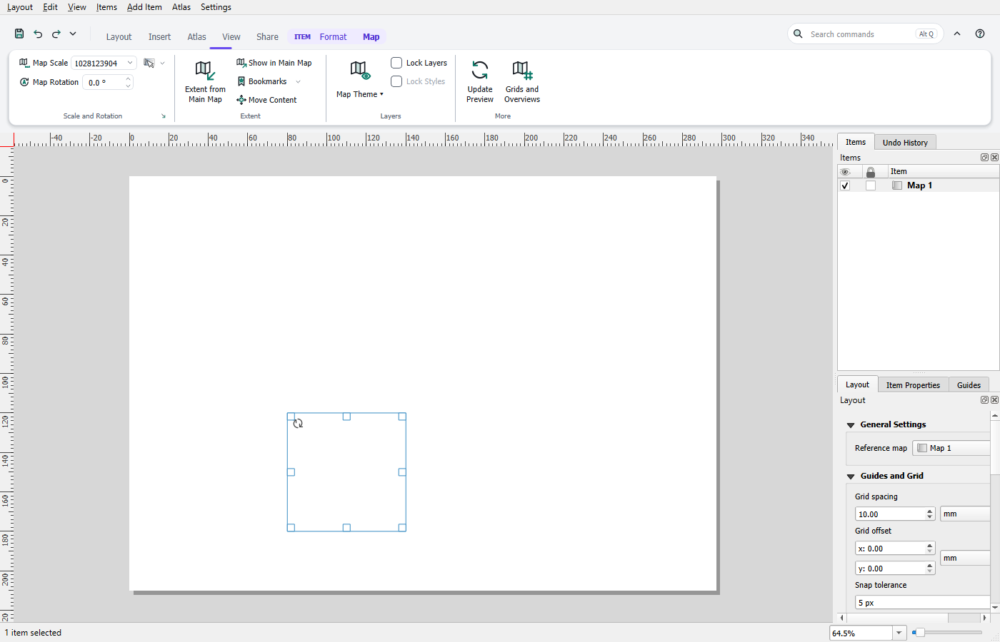
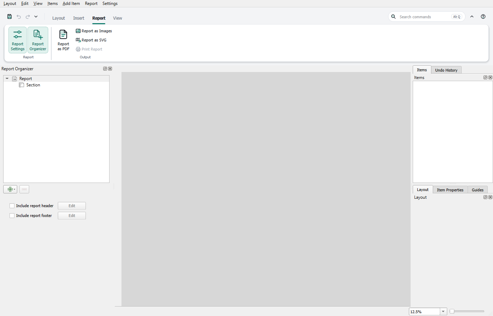

# Ribbon in the Layout Window

The window for print layouts and reports has a ribbon too. It replaces the QGIS toolbars there; the menu bar and the panels stay. Every open window has its own ribbon, and when it closes it restores the window the way QGIS knows it.

## Tabs

- **Layout:** clipboard, navigation, selection, page, and managing layouts.
- **Insert:** new layout, templates, maps, legend, scale bar, tables, text, pictures and shapes.
- **Atlas:** settings, preview, browsing and output. The **Feature** field jumps straight to a feature during the preview.
- **Report:** only for reports, see below.
- **View:** panels, rulers, grid, guides, snapping, preview and window.
- **Share:** export as PDF, image or SVG, print, and save as a template.
- **Extensions:** only when plugins put their own commands into the toolbars of the window.

## Tabs for the selected item

When items are selected, the **Format** tab appears with arrange, align, size and position, frame, background and appearance. With several items, the values apply to all of them.

With exactly one item, a tab for its kind is added: **Map**, **Text**, **Legend**, **Scale Bar**, **Picture**, **Shape** or **Table**. The **Item Properties** panel follows along, and **Undo** takes back every change. What is not on the tab opens in the panel through the small arrow at the bottom of the group.

## New layouts and page sizes

- **Insert › New Layout:** the menu on the button creates the layout right away with A4 or A3, landscape or portrait.
- **Insert › Layout from Template:** the list shows the templates (.qpt) from the QGIS template folders, **Choose Template File …** any other file. The new layout opens in its own window. In the main window the same button is on the **Share** tab.
- **Insert › Add from Template** instead brings the items of a template into the current layout.
- **Layout › Page Size:** A4 to A0, landscape or portrait, for the page shown. The items keep their place on the page.

## Reports

A report has no Atlas and Share tabs. Instead it has the **Report** tab with the settings, the **Report Organizer** panel, output as PDF, image or SVG, and printing.

The Layout and Insert tabs and the tabs for the selected item work with the section you are editing.

## Keyboard and search

**Alt** shows the KeyTips, **Alt** and **Q** goes to the search, as in the [main window](keyboard.md). The search finds the commands of the layout ribbon and the other actions of this window.

## Customizing

Right-click, the ▾ menu and the editor work as in the main window, see [Customizing the ribbon](customize.md). Tabs, groups, Quick Access and KeyTips are separate for each kind of window: the editor in the layout window changes only the layout window. A saved **arrangement** and an exported file, on the other hand, contain both windows.

## What applies to both windows

**Appearance**, **Kontur for All of QGIS**, **Hide QGIS Menu Bar** and the **classic QGIS interface** apply to all windows alike. The classic interface also brings the toolbars back in the layout window.

## Turning the ribbon off in the layout window

**Ribbon in Layout Window** is in the ▾ menu of the Quick Access Toolbar and in the right-click menu. When it is off, the layout window shows the QGIS toolbars and the main window keeps its ribbon. The switch takes effect at once, also for open windows.

The plugins' own toolbars stay visible in the layout window, as a second row below the ribbon.
