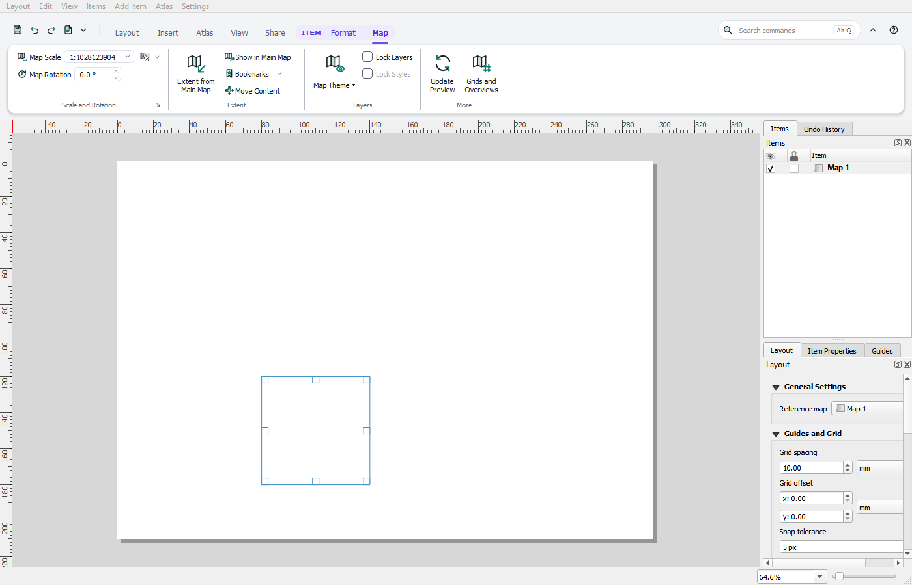
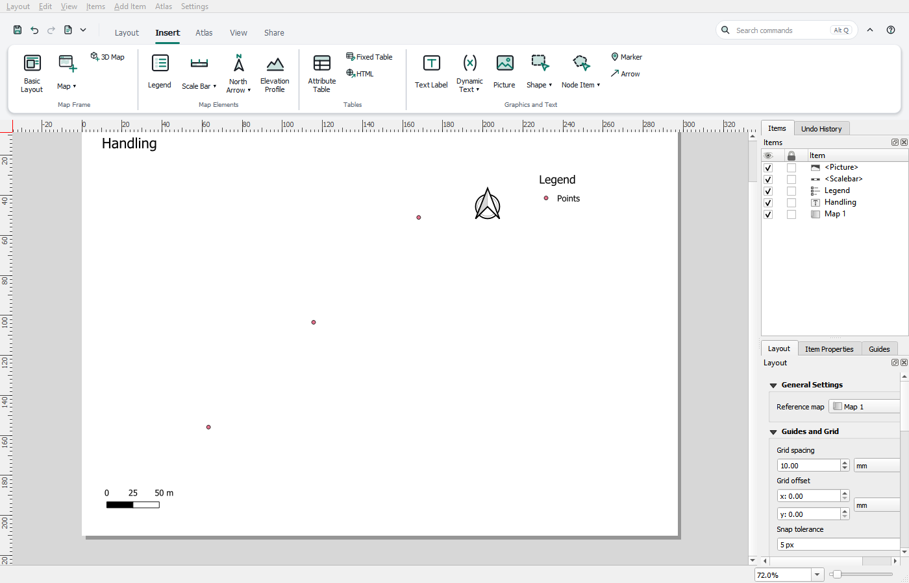
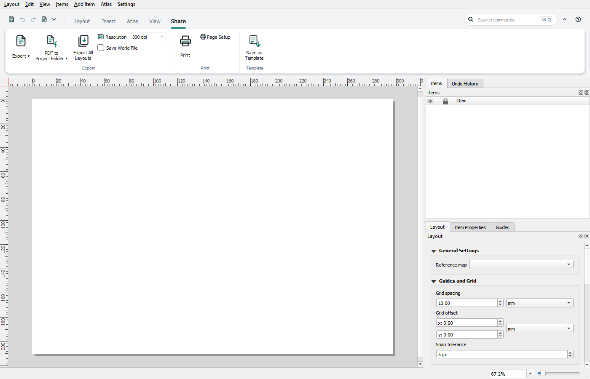
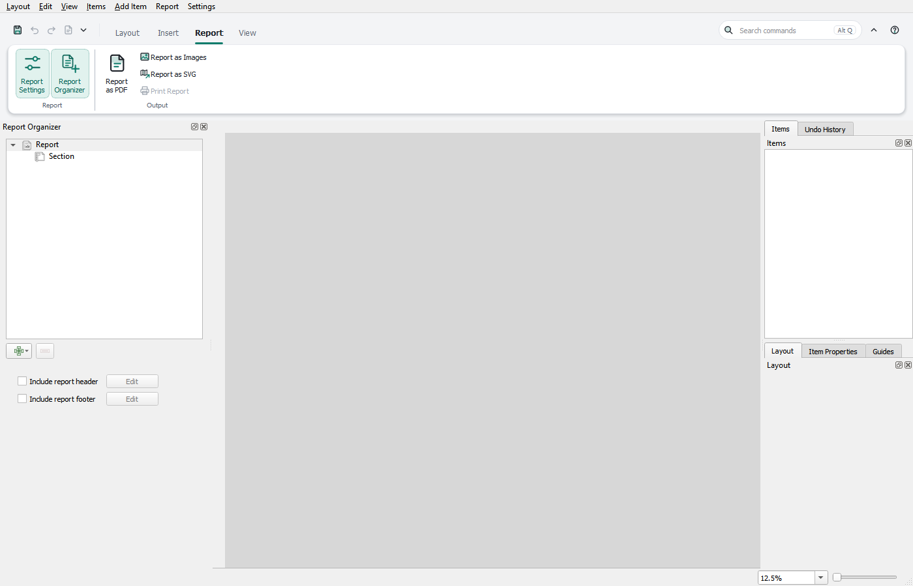

# Ribbon in the Layout Window

The window for print layouts and reports has a ribbon too. It replaces the QGIS toolbars there; the menu bar and the panels stay. Every open window has its own ribbon, and when it closes it restores the window the way QGIS knows it.

## Tabs

- **Layout:** clipboard, selection, page, navigation, and layout (create, open, manage).
- **Insert:** maps, legend, scale bar, tables, text, pictures and shapes.
- **Atlas:** settings, preview, browsing and output. The **Feature** field jumps straight to a feature during the preview.
- **Report:** only for reports, see below.
- **View:** panels, rulers, grid, guides, snapping, preview and window.
- **Share:** export as PDF, image or SVG, print, and save as a template.
- **Extensions:** only when plugins put their own commands into the toolbars of the window.

## Tabs for the selected item

When items are selected, the **Format** tab appears with arrange, align, size and position, frame, background and appearance. With several items, the values apply to all of them.

With exactly one item, a tab for its kind is added: **Map**, **Text**, **Legend**, **Scale Bar**, **Picture**, **Shape** or **Table**. The **Item Properties** panel follows along, and **Undo** takes back every change. What is not on the tab opens in the panel through the small arrow at the bottom of the group.

## New layouts and pages

- **Layout › New Layout:** the menu on the button creates the layout right away with A4 or A3, landscape or portrait.
- **Layout › New Layout › Layout from Template:** the list shows the templates (.qpt) from the QGIS template folders, **Choose Template File …** any other file. The new layout opens in its own window. In the main window the same button is on the **Share** tab.
- **Layout › Manage:** **Add from Template** brings the items of a template into the current layout. Also Duplicate, Rename, Delete, the Layout Manager and the Layout Properties.
- **Layout › Page Size:** A4 to A0, landscape or portrait, for the page shown. The items keep their place on the page.
- **Orientation** swaps portrait and landscape for the page shown, **Delete Page** deletes it (the last page of a layout stays), **Margin Guides** places four guides 5 to 20 mm from the edges of the page. With several pages, **Go to Page** shows a page in full. Each of these commands is one step for **Undo**. The small arrow at the bottom of the Page group opens the page properties.

The Quick Access Toolbar offers Save, Undo, Redo and export as PDF.

## Inserting ready-made items

On the **Insert** tab, maps, scale bars and north arrows arrive on the page ready to use. Clicking the button draws the item with the mouse as before; the menu below offers the same first (**Draw …**) and then the choices:

- **Map:** **Current Map View**, every map theme of the project (the map follows the theme) and every bookmark. On a page without a map, the new map fills the page up to 10 mm from the edge.
- **Scale Bar:** every QGIS style. The scale bar is linked to the map and sits at the lower left below it; without room there, at the lower left inside the map.
- **North Arrow:** the QGIS north arrows. The arrow is linked to the map, rotates with it and sits 20 × 20 mm in the upper right corner of the map.

The reference is the reference map of the layout (Layout Properties), otherwise the first map. Without a map, scale bars and north arrows are gray in the menu. **Basic Layout** adds what the page is missing: title (project title, otherwise the layout name), map, legend, scale bar and north arrow, arranged for the size and orientation of the page. An existing map stays. Each insert is one step for **Undo**; the new item is selected afterwards.

## Export and atlas

- **Share › Export:** the button exports as PDF, its menu as image or SVG. **Resolution** sets the export resolution of the layout (96 to 600 dpi or your own number), **Save World File** saves a world file next to exported images.
- **PDF to Project Folder** exports without a dialog to `<folder>/<layout name>.pdf`. The ribbon asks for the folder the first time and remembers it in the project; the menu on the button chooses another one. If the file exists, it asks before overwriting; you can turn that off for the project. The message at the top of the window links to the file.
- **Export All Layouts** shows the layouts of the project to check, the format (PDF or PNG) and the folder. A layout with an atlas becomes one PDF, as PNG a folder with one image per feature. The same button is on the **Share** tab of the main window.
- **Atlas:** **Atlas from Active Layer** takes the active layer of the main window, lets the map follow the atlas (10 % margin) and shows the preview. Coverage layer (empty turns the atlas off), page name, filter and sorting are fields in the ribbon and follow the Atlas panel.
- **Format › Copy Format** remembers frame, background, opacity and blend mode of the selected item, for text also font, color and alignment. **Paste Format** applies that to all selected items (text settings only to texts), as one step for **Undo**.

## Reports

A report has no Atlas and Share tabs. Instead it has the **Report** tab with the settings, the **Report Organizer** panel, output as PDF, image or SVG, and printing.

The Layout and Insert tabs and the tabs for the selected item work with the section you are editing. As long as no section is selected, the commands of the Page group and Basic Layout are gray.

## Keyboard and search

**Alt** shows the KeyTips, **Alt** and **Q** goes to the search, as in the [main window](keyboard.md). The search finds the commands of the layout ribbon and the other actions of this window.

## Customizing

Right-click, the ▾ menu and the editor work as in the main window, see [Customizing the ribbon](customize.md). Tabs, groups, Quick Access and KeyTips are separate for each kind of window: the editor in the layout window changes only the layout window. A saved **arrangement** and an exported file, on the other hand, contain both windows.

## What applies to both windows

**Appearance**, **Kontur for All of QGIS**, **Hide QGIS Menu Bar** and the **classic QGIS interface** apply to all windows alike. The classic interface also brings the toolbars back in the layout window.

## Turning the ribbon off in the layout window

**Ribbon in Layout Window** is in the ▾ menu of the Quick Access Toolbar and in the right-click menu. When it is off, the layout window shows the QGIS toolbars and the main window keeps its ribbon. The switch takes effect at once, also for open windows.

The plugins' own toolbars stay visible in the layout window, as a second row below the ribbon.
