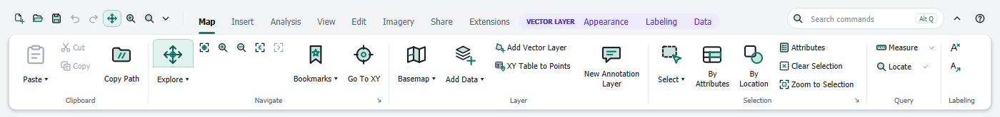
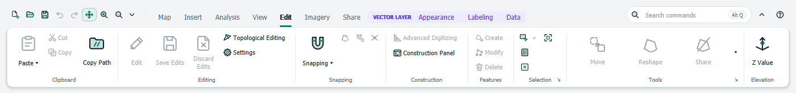
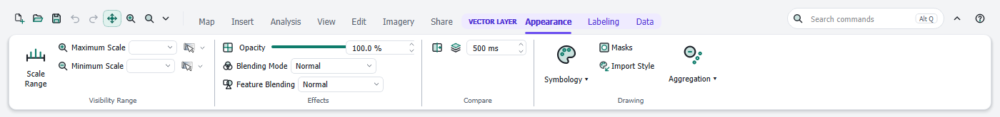
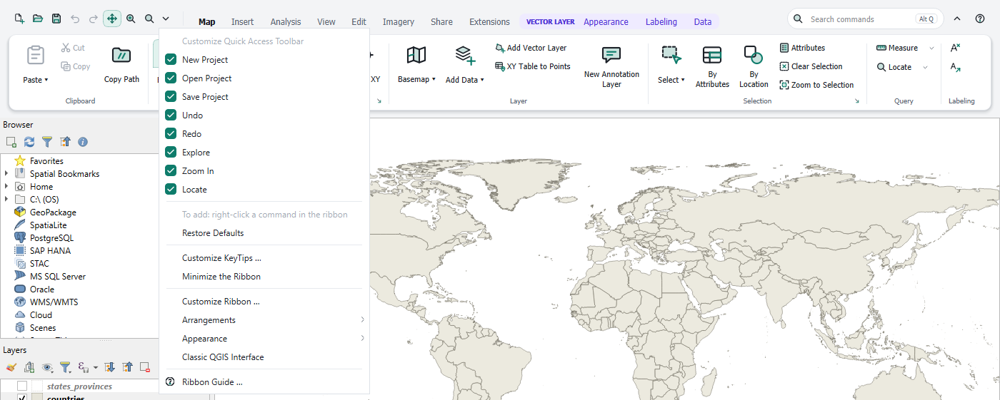
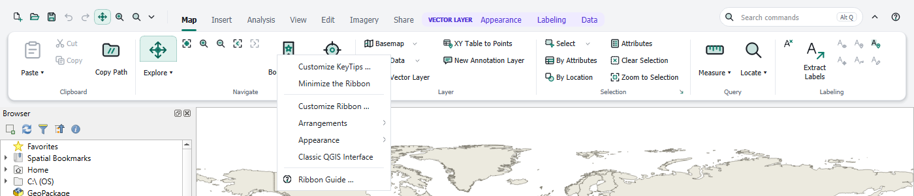
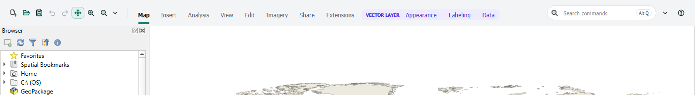

# Working with the ribbon

[Contents](index.md)

The ribbon consists of the **header** (Quick Access Toolbar, tabs, command search, minimize and help buttons) and the **ribbon area** with the groups of the selected tab.

## Tabs

| Tab | Groups |
|---|---|
| Map | Clipboard, Navigate, Layer, Selection, Query, Labeling |
| Insert | Project, New Layers, Styles, Favorites |
| Analysis | Geoprocessing, Tools |
| View | Link, Windows, Accessibility, Navigation |
| Edit | Clipboard, Editing, Snapping, Construction, Features, Selection, Tools, Elevation |
| Imagery | Align, Analysis |
| Share | Package, Save As, Output |
| Extensions | commands of installed plugins, see [Extensions](extensions.md) |

When you start editing a layer, the ribbon switches to the **Edit** tab. It does not leave a tab of your own (see [Customizing the ribbon](customize.md)); your workflow stays in place.

In **Editing**, **Edit**, **Save** and **Discard** act on the active layer only; editing stays on after saving or discarding. **Save All** and **Discard All** act on every layer being edited. QGIS asks before discarding.

**Construction › Advanced Digitizing** turns the construction aids on or off (distance, angle, coordinates while digitizing). It is available while a tool that supports it is active, for example **Create** or **Modify**. The panel does not open with it; **Construction Panel** in the button's dropdown shows or hides the panel without switching the aids on or off. The small icons in **Snapping** switch tracing, self-snapping and snapping to intersections.

## Contextual tabs

Some tabs only appear when they fit the active layer in the Layers panel. They stand on the right in a colored frame with the name of their context:

- **Vector Layer:** Appearance, Labeling, Data
- **Table** (layer without geometry): Data
- **Raster Layer**, **Vector Tiles**, **Point Cloud**, **Mesh:** Appearance
- **Group** (a group selected in the Layers panel): Appearance

**Appearance** starts with the same groups in every context:

- **Visibility Range:** the largest and smallest scale at which the layer is drawn.
- **Effects:** opacity and blending mode of the layer with the layers below (for example *Multiply* for a hillshade under a map). **Feature Blending** (vector layers only) blends the features of the layer with each other.
- **Compare:** **Swipe** is a map tool: drag across the map with the mouse button pressed; behind the edge the layer is hidden and reveals the layers below. The direction of the drag decides whether the edge is vertical or horizontal; when you release the button the whole layer is shown again. **Flicker** hides and shows the layer at the set interval (milliseconds) until you switch it off or select another layer. Neither changes the layer list or the project.

The groups for the layer type follow, for example **Aggregation** for point layers (point cluster, point displacement, heatmap; **None** restores the previous symbology), the **Renderer**, **Point Size** and **Max. Error** of a point cloud, or the displayed datasets (**Scalar**, **Vectors**) and the **Mesh Frame** of a mesh.

For vector layers the **Symbol** group follows **Drawing**: choose a category, class or rule under **Class** (or click the class in the Layers panel), then change **Fill Color**, **Outline Color** and **Width** directly. Width is the size for points, the line width for lines and the outline width for polygons. With **All categories** (or **All classes**, **All rules**) the width applies to every class; the colors are gray then, because each class has its own. With a single symbol there is nothing to choose, so **Class** is gray. **Edit Symbol** opens the QGIS symbol editor for the chosen class. Every change can be undone as in the Layer Styling panel. If a value is set by an expression, the field stays gray; the tooltip says why.

**Group:** opacity, blending mode and visibility range apply to the whole group. QGIS only has them when the group is *rendered as a group*; the first change switches that on (button **Render as Group**; switching it off removes the group's settings). **Exclusive** keeps only one layer of the group visible; the Layers panel then shows circles instead of check boxes. **Zoom to Group** shows all of its layers.

**Data** of a vector layer or a table: the group **Fields** creates fields (**Add Field**: name, type, length, precision, alias, comment), **deletes** and **renames** them; next to them the **Field Calculator**. In edit mode the change goes into the edit buffer and can be undone, otherwise it is written to the data source directly after confirmation. If the data source cannot change fields, the buttons are grayed out. **Fields** under Data Design opens the field list of the layer properties.

**Labeling** for a vector layer: **Label** switches the labels on. A line layer then gets the placement *Parallel*, because QGIS does not draw line labels with *Around point*. A layer can have several **label classes**, each for its own features with its own text and style. Choose a class in the list; the buttons next to it create a **new class** (a copy of the selected one) or **delete** the selected class. **Filter** decides which features a class labels, **Label Class Features** switches the class on or off, and **Field** chooses the field for the text; its button ε opens the expression editor for a text built from several fields.

**Label Classes** (first button of the group) switches between labeling by class and one simple label. With classes on, every group of the tab (visibility range, text symbol, placement) shows and changes only the class chosen in the list; the scale limits are stored in the scale range of the class, the same values the rule list of the layer properties shows. With classes off, the groups control the simple label and the class commands are grayed out. Switching never loses anything: the version you leave is kept in the project and comes back unchanged. The first time classes are switched on, the simple label becomes the class *Default*, switched off, so that nothing is labeled twice; **New Class** creates a class that is switched on.

Commands that cannot be used at the moment (for example *Clear Selection* without a selection) are grayed out.

## Buttons, menus and galleries

- **Large, medium and small buttons** run a command. Buttons that switch something on or off (for example a map tool) stay highlighted while active.
- **Split buttons** have two parts: the upper or left part runs the main command, the arrow ▾ opens related commands.
- **Menus** (label with ▾) open a list of commands.
- **Galleries** show a selection of tools or styles (for example the geoprocessing tools in the Analysis tab). The arrow at the side shows all items. Which items appear can be changed, see [Customizing the ribbon](customize.md).
- **Controls** such as fields for scale, opacity or font act directly on the active layer.
- **Dialog launcher:** the small arrow ↘ in the lower right corner of a group opens the matching QGIS dialog with more settings.
- **Tooltips** show the name, a description and the keyboard shortcut of a command.

When the window is narrow, groups on the right collapse into a single button. A click on it shows the group as a drop-down.

## Quick Access Toolbar

The small icons at the left of the header are the **Quick Access Toolbar**. Its commands are available whichever tab is selected.

- **Add a command:** right-click a command in the ribbon and choose **Add to Quick Access Toolbar**.
- **Remove a command:** uncheck it in the ▾ menu, or right-click it and choose **Remove from Quick Access Toolbar**.
- **Order:** in the editor, see [Customizing the ribbon](customize.md).
- **Restore Defaults** in the ▾ menu restores the shipped commands.

The ▾ menu also contains the settings of the ribbon: KeyTips, minimizing, the editor, arrangements, appearance, hiding the QGIS menu bar, the classic QGIS interface and this guide. The same entries are in the right-click menu of the ribbon:

## Minimizing the ribbon

The ribbon can be reduced to its header to leave more room for the map:

- the **^** button at the right of the header,
- **Ctrl+F1**,
- double-click a tab,
- **Minimize the Ribbon** in the ▾ menu or the right-click menu.

While minimized, a click on a tab shows the ribbon above the map. It closes again when you click outside it. To show the ribbon permanently, use the pin button, Ctrl+F1, or double-click a tab again. The state is kept for the next start.

## Command search

The search field at the right of the header finds commands by name or description, see [Keyboard: KeyTips and search](keyboard.md).
