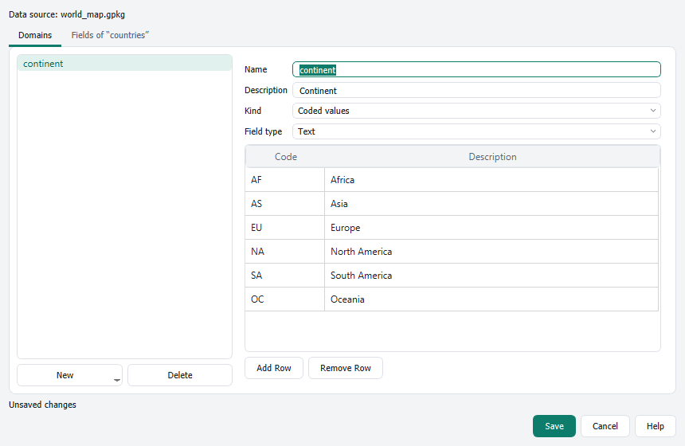

# Additional tools

[Contents](index.md)

Most commands of the ribbon call existing QGIS functions. Where QGIS has no matching single command, the ribbon brings its own. They can be found with the [command search](keyboard.md) like all other commands.

## Domains

**Domains** (contextual tab **Data** of a vector layer or table, group **Data Design**) manages attribute domains: lists of allowed values (coded values) or ranges, and the fields they apply to.

- **Domains** tab: **New** creates a domain with coded values or a range. Enter name, description, kind and field type. For coded values, add rows with code and description.
- **Fields of …** tab: assign a domain to each field of the layer.
- **Save** writes the domains. In a GeoPackage or another data source that supports field domains, they are stored there; otherwise in the QGIS project.
- In the attribute form, the fields get a matching drop-down list or range check.

Problems such as values that do not fit the field type are shown below the list, and saving is blocked until they are solved.

## Other own commands

| Command | Location | Effect |
|---|---|---|
| Copy Path | Map › Clipboard | copies the data source path of the active layer |
| Basemap | Map › Layer | adds a basemap (for example OpenTopoMap) |
| Bookmarks | Map › Navigate | spatial bookmarks as a gallery |
| Select by Line | Map › Selection | selects features crossed by a drawn line |
| Locate | Map › Query | moves the focus to the QGIS locator bar |
| Rotation, Magnifier | View › Navigation | rotation and magnification of the map |
| Scale Range, Opacity, Blending Mode | Vector Layer › Appearance | settings of the active layer |
| Labeling controls | Vector Layer › Labeling | field, font, size, color and placement of labels |
| Brightness, Contrast, Gamma, Band Combination | Raster Layer › Appearance | display of the active raster |
